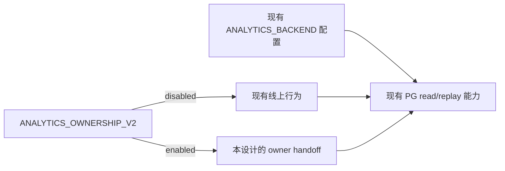
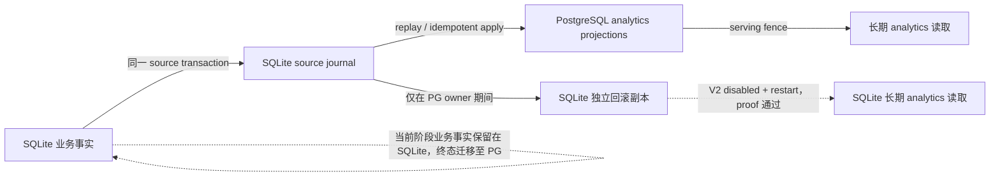
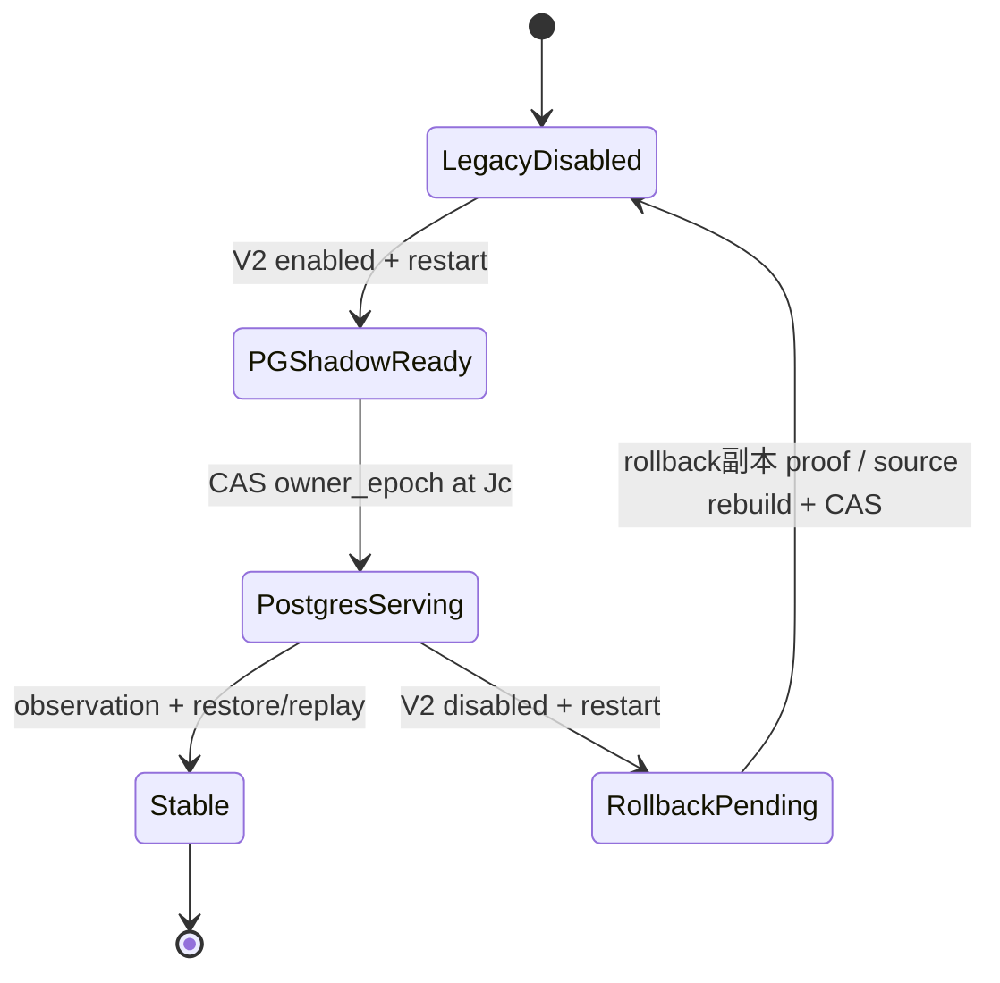
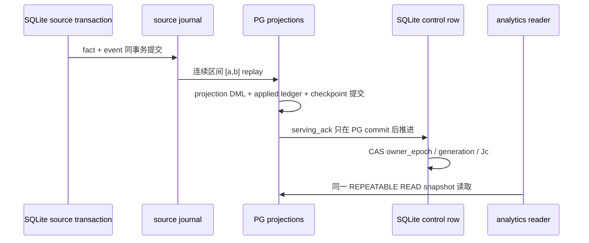

# Analytics 模块 PostgreSQL 写入归属迁移设计

## 目标和边界

当前迁移阶段由 SQLite 继续保存业务事实和 source journal；PostgreSQL 接管长期 analytics 派生数据的写入、维护和查询。首轮范围是 facts、parallel-work keys、daily/hourly rollups、interval/read models 及其状态；`Summary All`、live overlay、业务事实、原始 payload、archive source 不在本次 cutover 范围内。最终路线是先完成本方案的 analytics ownership cutover，再将业务事实迁移到 PostgreSQL，最后清退 SQLite 业务存储。

当前 `src/long_term_stats/` 和部分查询路径仍直接读写 SQLite。所有这些路径完成表级改路由前，不能宣称 PostgreSQL 已成为模块 owner。

## 配置开关

现有 `ANALYTICS_BACKEND` 继续控制当前已经上线的 PG read/replay 能力；本设计不修改它，也不使用它作为新方案的开关。新增一个独立变量：`ANALYTICS_OWNERSHIP_V2=disabled|enabled`，默认值为 `disabled`。

| 配置                              | 运行行为                                                                                                                           |
| --------------------------------- | ---------------------------------------------------------------------------------------------------------------------------------- |
| `ANALYTICS_OWNERSHIP_V2=disabled` | 保持现有线上行为：现有 PG read/replay 能力继续运行，SQLite 继续写当前派生表；不启动本设计的 owner lease、表级 handoff 和回滚副本。 |
| `ANALYTICS_OWNERSHIP_V2=enabled`  | 启动本设计的 shadow、表级映射、owner epoch、PG 派生写入和统一 serving fence；证明完成后才切换长期 analytics 的读写来源。           |

修改这个变量后重启同一个应用容器即可生效。启动时必须读取 durable owner state：`disabled` 遇到 `postgres_owned` 要先执行受控回滚再进入现有行为；`enabled` 遇到 `sqlite_owned` 要先完成 shadow/parity/handoff；任何不一致都保持 analytics unavailable，不得静默切换或同时启动两套完整 writer。



## 数据流和唯一 serving owner



`SQLite 独立回滚副本`是单独的 analytics 派生表，不拥有业务事实、不参与正常查询、不写 PostgreSQL 表。它只在 rollback window 内从同一 Journal 保持可提升状态；如果 proof 不完整，回滚改走 source rebuild。

## 表级映射和最终归宿

| SQLite 当前对象                                                                                                                                                                                       | PostgreSQL 对象                                                     | handoff 前                              | handoff 后                                  | SQLite 最终归宿                                                                 |
| ----------------------------------------------------------------------------------------------------------------------------------------------------------------------------------------------------- | ------------------------------------------------------------------- | --------------------------------------- | ------------------------------------------- | ------------------------------------------------------------------------------- |
| `codex_invocations`、`pool_upstream_request_attempts`                                                                                                                                                 | 无；本阶段业务事实不迁移                                            | SQLite 写入/读取，PG 只消费 Journal     | SQLite 继续写入，PG 从 Journal 生成事实     | 本阶段保留并按业务 retention 管理；未来业务事实迁移到 PG 后清退                 |
| `analytics_change_events`、`analytics_change_state`、`analytics_change_coverage`                                                                                                                      | 无；PG 只保存消费 checkpoint                                        | SQLite 是本阶段 Journal 权威            | SQLite 继续追加，PG 记录 checkpoint/ack     | handoff 期间必须保留；未来 PG 接管业务事实后由 source-migration 方案决定清退    |
| `long_term_usage_daily`                                                                                                                                                                               | `cvm_analytics.analytics_daily_rollups`（已有）                     | SQLite 表 serving，PG 表 shadow         | PG 表读写；SQLite 改写独立回滚日表          | rollback window 和 cleanup gate 后删除 SQLite 派生表                            |
| `long_term_usage_hourly`                                                                                                                                                                              | `cvm_analytics.analytics_hourly_rollups`（已有）                    | SQLite 表 serving，PG 表 shadow         | PG 表读写；SQLite 改写独立回滚小时表        | rollback window 和 cleanup gate 后删除 SQLite 派生表                            |
| 无独立 SQLite serving 表；来源是 `analytics_change_events`                                                                                                                                            | `cvm_analytics.analytics_facts`（已有）                             | PG shadow，不对外读                     | PG maintenance writer 写，PG reader 读      | 若需快速回滚，保留独立 SQLite 回滚 fact 表；cleanup gate 后删除，否则回滚时重建 |
| 无独立 SQLite serving 表；来源是 `analytics_change_events`                                                                                                                                            | `cvm_analytics.analytics_parallel_work_keys`（已有）                | PG shadow，不对外读                     | PG maintenance writer 写，PG reader 读      | 若需快速回滚，保留独立 SQLite 回滚 key 表；cleanup gate 后删除，否则回滚时重建  |
| `long_term_stats_state`、`long_term_stats_repair_queue`                                                                                                                                               | `analytics_state` 加新增 `analytics_projection_state`               | SQLite 状态驱动旧投影                   | PG 状态驱动 serving projection              | PG 接管并完成 restore/replay 后删除旧派生状态                                   |
| `long_term_projection_state`                                                                                                                                                                          | `analytics_replica_state` 加新增 `analytics_projection_checkpoints` | SQLite cursor 与 PG replica cursor 并存 | PG checkpoint 决定 serving fence            | rollback window 后删除旧 SQLite cursor/state                                    |
| `long_term_projection_dirty_buckets`、`long_term_projection_bucket_state`、`long_term_projection_daily_backups`、`long_term_projection_date_publications`、`long_term_projection_daily_backup_claims` | 新增 PG repair/bucket/publication state                             | SQLite 维护旧 serving rollup            | PG maintenance writer 维护                  | PG parity、restore/replay、cleanup gate 后删除                                  |
| `long_term_projection_intervals`、`long_term_projection_interval_state`、`long_term_projection_interval_suppressions`、`long_term_projection_rebuild_members`                                         | 新增 PG interval/read-model tables                                  | SQLite 支撑当前查询                     | PG 对应表读写；缺少对应表则禁止 owner claim | PG parity 和 rollback window 后删除                                             |
| `hourly_rollup_archive_*`、`long_term_projection_archive_compatibility`                                                                                                                               | 无 serving target                                                   | SQLite archive/source maintenance       | 仍由 SQLite 管理，PG 只消费已验证 archive   | 按 archive maintenance retention 管理，不属于 serving 清理                      |
| `cvm_analytics.analytics_replica_applied_changes`                                                                                                                                                     | PG 内部 ledger                                                      | PG shadow ledger                        | 改为 `(projection, change_id)` 幂等 ledger  | 作为 PG replay state 保留或按 PG retention 压缩                                 |

“无独立 SQLite serving 表”表示没有一张 SQLite 派生表提供同一查询结果，不表示没有来源；来源明确是 SQLite Journal event。它是 `Journal → PG projection`，不是 `SQLite 表 → PG 表` 复制。

## 五阶段状态对比



| 阶段       | V2 开关          | serving owner                | 读取来源                                               | 派生写入                                     | Journal/水位                                            | SQLite 派生表最终状态                            |
| ---------- | ---------------- | ---------------------------- | ------------------------------------------------------ | -------------------------------------------- | ------------------------------------------------------- | ------------------------------------------------ |
| 上线前     | disabled         | SQLite                       | `long_term_usage_*`、SQLite interval 表                | SQLite serving 表；PG shadow 不启用 V2 owner | PG shadow 追到 `Jc`，不改变现有 source ack              | 原表继续服务                                     |
| 过渡期     | enabled          | SQLite → PG，一次 fence 切换 | CAS 前读 SQLite；CAS 后只读 PG                         | PG 写 `analytics_*`；SQLite 写独立回滚表     | `serving_ack` 切到 PG；`retention_floor` 覆盖 PG+回滚表 | 原 serving 表停止服务，回滚表继续更新            |
| 完成后     | enabled          | PG                           | PG facts/keys/rollups/interval/read models             | PG serving projections；SQLite 只写回滚表    | PG serving lag 可观测；retention floor 不得落后         | rollback window 内保留，之后按 cleanup gate 删除 |
| 回滚过渡期 | disabled，重启中 | unavailable                  | SQLite 回滚表验证或 source rebuild；PG 保留现场        | Journal 不跳过，容量不足则 backpressure      | proof 通过后进入现有行为，否则继续 unavailable          |                                                  |
| 回滚后     | disabled         | 现有线上读路径               | 现有 SQLite 派生写入恢复；PG 保持现有 replay/read 能力 | 新 SQLite fence；PG 可重新 bootstrap         | PG 现场保留；废弃 SQLite 派生表按 cleanup gate 管理     |                                                  |

## Handoff、确认和读取合同



- `serving_ack` 是所有 PG serving projections 的最小连续 checkpoint；`retention_floor` 还要等待 SQLite 回滚副本。
- 重复事件用 `(projection, change_id)` 和 `(source, source_row_id)` 去重；generation、retention gap、schema mismatch 直接 fence，禁止跳过。
- handoff 前 PG 必须覆盖 `Jc`，所有 facts/keys/rollups/interval/read models 使用同一 generation、revision 和 fence；否则不得 CAS owner。
- PG 读取不回退 SQLite；handoff 或 rollback proof 未完成时返回 unavailable。

## 完整性证明和最终清理

| 证明              | 必须证明                                                             | 失败结果                |
| ----------------- | -------------------------------------------------------------------- | ----------------------- |
| Source/archive    | manifest、SHA、schema、bounds、row count 一致                        | PG 不得 serving         |
| Snapshot/Journal  | `J0`、`Jc`、generation 连续，无缺口和跨代跳跃                        | 新 generation bootstrap |
| Identity/digest   | source identity、canonical tuple digest、事实字段一致                | projection invalidated  |
| Projection parity | facts、keys、daily/hourly、interval/read model 与重算一致            | 不发布 fence            |
| Post-handoff      | 每个 serving watermark 可追溯到 owner epoch 和已提交 checkpoint      | 读返回 unavailable      |
| Cleanup gate      | observation、restore/replay、rollback window、容量和备份证据全部通过 | SQLite 派生表继续保留   |

最终清理只允许删除不再 serving 的 SQLite 派生表、回滚副本和旧 projection state；业务事实、source journal、archive source 和 archive maintenance metadata 不属于本次清理。

## Docker 合同

两个 env file 使用同一个现有 PG read/replay 配置，只改变本设计的一个开关：

```sh
docker compose --env-file deploy/analytics-ownership-v2-disabled.env up -d --wait
docker compose --env-file deploy/analytics-ownership-v2-enabled.env up -d --wait
```

`disabled → enabled` 的重启会保留现有 PG read 能力，启动 shadow 并在 proof 通过后执行 handoff；`enabled → disabled` 的重启会先 fence PG owner，验证回滚副本或执行 source rebuild，再恢复现有线上行为。不得通过修改 `ANALYTICS_BACKEND`、第二个完整业务容器、手工 SQL、手工 archive copy 或隐式 fallback 实现切换。

## 实现验收清单

- [ ] 完成上表所有 SQLite→PG 对应关系；新增 PG target 缺一项就不能 claim owner。
- [ ] 所有长期 analytics 读取入口完成表级切换，且一次读取只使用一个 serving fence。
- [ ] source transaction、Journal replay、projection checkpoint、owner epoch 和 applied ledger 可重放、可 fencing。
- [ ] 完成 archive/snapshot/digest/parity proof，覆盖 generation、retention gap 和 tombstone。
- [ ] 验证 `ANALYTICS_OWNERSHIP_V2` 两次重启切换、handoff 中断、PG 故障、rollback rebuild、backpressure、restore/replay 和最终 cleanup gate。

## 已确定的运行参数

- `rollback_window` 固定为 1 天。PG serving 期间，SQLite rollback projection 至少保留完整 1 天；cleanup gate 通过后才允许删除。
- Journal 与 rollback projection 采用自动容量策略：系统按最近生产数据估算 1 天峰值，并加安全余量；同时以事件数和字节数设界。设计不要求主人预先提供静态数字，部署实现负责把估算结果转成可观测配置。
- 容量接近安全边界时告警；达到硬上限前必须触发 backpressure，禁止淘汰尚未被 PG 消费的 Journal 事件、跳过 replay 或伪造 coverage。容量不足时 analytics 保持 unavailable，source 写入按既有业务优先级受控延期。
- `observation_window` 与 `rollback_window` 合并为 1 天。成功条件包括 handoff parity、至少一次重启/restore/replay、持续 serving 健康和 Journal 无缺口；未满足时继续保留 rollback projection。

## 终态路线

本方案只定义 analytics projection 的第一阶段 ownership cutover。第二阶段单独迁移业务事实和 source journal 的写入权到 PostgreSQL，并建立 PG 侧事实保留与回滚合同；第三阶段在业务事实、analytics projection、archive source 和恢复证据全部完成迁移后，清退 SQLite 业务存储。第二、三阶段不通过本方案的 cleanup gate 偷渡完成，也不把当前阶段的 SQLite 事实保留误写成永久架构。

## 代码和现有文档依据

- [`src/analytics_changes.rs`](../../src/analytics_changes.rs)
- [`src/long_term_stats/schema.rs`](../../src/long_term_stats/schema.rs)
- [`src/long_term_stats/intervals.rs`](../../src/long_term_stats/intervals.rs)
- [`src/long_term_stats/projection_rebuild.rs`](../../src/long_term_stats/projection_rebuild.rs)
- [`src/pg_analytics/schema.rs`](../../src/pg_analytics/schema.rs)
- [`src/pg_analytics/read.rs`](../../src/pg_analytics/read.rs)
- [`docs/specs/pg18-analytics/SPEC.md`](../specs/pg18-analytics/SPEC.md)
