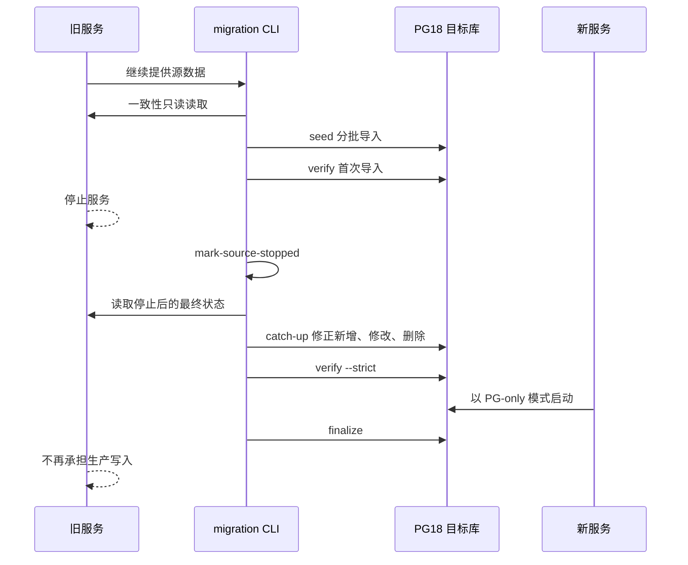

# PostgreSQL 18 全量数据库迁移设计

本文定义将现行服务的全部数据库状态迁移到 PostgreSQL 18 的目标、边界、CLI 能力、导入阶段和验收门禁。迁移只允许从旧服务及其数据源流向新服务及其 PostgreSQL 目标库；本文不设计目标库回写旧数据源的路径。

## 已确认的设计决策

| 项目              | 决策                                                                                         |
| ----------------- | -------------------------------------------------------------------------------------------- |
| 数据范围          | PostgreSQL 承担全部数据库状态；大型文件继续由现有文件资产存储，PG 保存完整索引、元数据和引用 |
| 目标库结构        | 一个 PostgreSQL 18 数据库，按领域划分 schema                                                 |
| 服务关系          | 旧服务是迁移源，新服务是 PG-only 目标服务                                                    |
| 首次导入          | 旧服务继续运行时执行一致性首次导入                                                           |
| 最终追平          | 停止旧服务后执行最终追平导入                                                                 |
| 数据方向          | 旧服务 → 新服务，单向迁移                                                                    |
| 回退              | 不提供回退功能；导入失败时暂停、修复、继续或重建目标导入                                     |
| 部署位置          | 继续部署在 101，但使用扩容后的独立 volume 和独立 stack                                       |
| 当前 analytics PG | 只作为对照和验证对象，不作为全量迁移输入                                                     |

## 目标与非目标

目标是让新服务可以独立使用 PostgreSQL 18 完成业务数据的读取和写入，并保持现有业务 ID、关联关系、时间语义、配置语义、统计语义和文件引用语义。目标库必须可以通过 CLI 进行初始化、断点续跑、最终追平、校验和完成标记。

本文不把当前 PostgreSQL analytics 副本扩展成全库迁移源。本文只规定两个服务之间的数据迁移和新服务使用 PG18 的数据库边界。

## 数据边界

PG18 目标库必须承载当前数据库中的业务状态、配置状态、账户状态、路由状态、任务状态、调用记录、上游请求记录、统计投影、归档索引和其他需要持久化的关系数据。目标库不直接承载现有的大型文件资产；这些文件继续保存在文件资产目录中，PG 保存文件身份、路径、大小、摘要、生命周期和引用关系。

每个迁移对象必须声明自己的同步属性。当前 CLI 会根据对象名生成初始分类，正式目标库上线前仍应由对象清单复核分类：

- `immutable`：导入后内容不再变化，只需要校验和引用完整性。
- `append_only`：只追加新记录，导入器可以按稳定主键或源序号分批处理。
- `mutable`：已有记录可能被修改，最终追平时必须执行完整的更新和删除校验。
- `derived`：可以从已迁移的权威数据重建，导入器需要记录重建状态而不是把旧投影当作权威事实。

当前 analytics PG 中的事实表属于 derived 数据，不能替代旧服务的完整业务数据。

## 目标库结构

目标使用一个数据库和多个 schema，避免跨数据库事务和备份编排复杂化，同时保留领域边界：

```text
cvm_core       业务实体、配置、账户、路由和运行状态
cvm_activity   调用、上游请求、过程记录、时间线和 PG runtime 代理请求摘要
cvm_stats      summary、rollup、timeseries 和统计投影
cvm_archive    归档索引、归档状态和历史覆盖信息
cvm_assets     文件资产索引、摘要、引用和生命周期
cvm_migration  迁移运行、批次、断点、校验和错误状态
```

目标 schema 的每次结构变更都必须有迁移编号、checksum、兼容范围和可重入行为；当前代码已将 domain materialization、source key、target profile、源列声明类型、外键、唯一索引、外部资产清单、source root、资产索引、批次 source cursor 和失败后的恢复阶段记录为 migration schema version 10，并保留旧版本历史记录。目标库的业务角色不得执行 schema DDL；DDL 由一次性的迁移角色执行，导入角色只获得目标表所需的写权限。两个连接 URL 必须指向同一个 PostgreSQL 数据库，避免迁移 ledger 与导入数据分离。

业务连接池和迁移连接池分别由 `POSTGRES_PRIMARY_MAX_CONNECTIONS` 与 `POSTGRES_PRIMARY_MIGRATION_MAX_CONNECTIONS` 限制，两个值都必须为正整数。

代码侧的 `PrimaryDatabase` 提供 PG 连接、18.x 版本校验、六个业务 schema、角色 USAGE 权限、schema checksum 和 JSON 状态 store 边界；`PrimaryStateStore` 已提供 SQLite/PostgreSQL 双实现，统一 JSON 状态读写契约，并注入 `AppState` 作为后续 domain store 的共享边界。PG backend 启动路径会先执行 runtime schema 校验，再进入独立的 PG runtime；当前已提供健康检查、系统状态、系统存储、系统任务、managed tasks runtime/timeline、可观测性、调用记录分页、locate、pool-attempts、suggestions、new-count、summary/detail/workflow/body 读取、基础统计、dashboard activity/network、长期统计 overview、统计时间序列、性能统计、失败统计、其他错误、账户活动、forward-proxy 统计、并行工作、invocation timeline、最新配额、pool tags 和 model-routing-live 读取、聚合 settings、定价目录、代理模型 preset/delete、models.dev sync preview/apply/state、forward-proxy、pool routing settings、external API key 设置读写，以及上游账户列表、详情、API key 账户创建、批量 enable/disable/set_group/delete、单账户 patch/delete、账户事件、转发代理绑定节点和账户调用记录读取，其中 pool routing secret 与账户凭据使用 primary runtime 的加密密钥保存，响应不会返回密文。PG-only runtime 还提供 `/v1/{path}` 的上游转发：按 priority_tier（policy 覆盖）和账户 ID 稳定顺序构造启用且有凭据的候选，解密其 API key/OAuth access token，按账户的 upstream base URL 构造目标请求；连接失败、响应体读取失败或 429/5xx 会继续尝试后续候选，没有可用账户时沿用全局 upstream URL 和调用方授权头。请求沿用方法、查询参数和安全请求头，应用配置的请求体上限与上游超时，并将方法、路径、状态、字节数、耗时和错误摘要写入 `cvm_activity.proxy_requests`；该摘要不保存请求或响应正文。PG-only 路由会在 JWT access token 过期时使用 OAuth refresh token 更新加密凭据；账户的稳定前向代理绑定键已接入 PG 请求客户端，PG-only 上游响应支持流式转发和流结束摘要记录。managed task 的 PG 路由支持目录读取、单任务详情、`PATCH` 控制字段和 `POST /run` 请求入队，控制值与队列写入 `cvm_core.state_kv`，队列追加通过存储层事务原子完成，运行时接口会返回最多 100 条待执行请求；`verify_archive_storage` 已提供 PG-only 手动执行路径，会校验外部资产索引中的路径、文件大小和 SHA-256，并将结果映射回任务详情的最近执行信息。其他维护任务仍需后续维护域替换工作接入。迁移 materialize 会为整数单列主键创建并校准 PG identity sequence，为复合主键创建唯一索引；后续 domain store 应在该边界上逐域替换 SQLite 直接访问，SQLite store 继续保留给现有兼容测试。

## 迁移运行模型

一次迁移由 `run_id` 和 `target_profile` 标识。`cvm_migration.runs` 保存目标 profile，后续所有命令必须使用相同 profile；这样不同目标连接配置不能误操作同一个迁移 run。`cvm_migration` 至少保存以下状态：

| 状态             | 含义                                             |
| ---------------- | ------------------------------------------------ |
| `prepared`       | 源检查和目标 schema 检查完成，可以开始首次导入   |
| `seeding`        | 旧服务仍运行，正在导入一致性首次数据             |
| `seeded`         | 首次导入完成，已生成首轮校验结果                 |
| `source_stopped` | 旧服务已停止，允许执行最终追平                   |
| `catching_up`    | 正在读取停止后的最终源状态并修正目标             |
| `verified`       | 最终追平和全部验收检查完成                       |
| `finalized`      | 新服务已被标记为唯一目标服务                     |
| `paused`         | 当前批次停止，允许使用同一 `run_id` 继续         |
| `failed`         | 当前批次不可继续，必须修复后重试或重建该目标运行 |

每个批次记录源对象、源主键范围、目标表、处理行数、提交时间、checksum 和错误码。`verify` 还会检查整数主键对应的 PG sequence 不低于已导入最大值。重复执行同一批次必须得到相同结果，不能产生重复行或覆盖其他迁移运行。

## CLI 设计

CLI 作为一次性迁移工具运行，不作为第三个长期服务。目标 PG 连接信息通过受保护的环境或 service profile 提供，不放入 shell 历史和命令行参数。

### 源检查

```bash
codex-vibe-monitor migrate inspect-source \
  --source-root /srv/old-service/data
```

`inspect-source` 只读检查源数据库 schema、表目录、文件资产目录、对象类型、估算规模、主键范围、时间范围和可读性，输出机器可读的 source manifest。它不修改旧服务或源数据。

### 准备目标

```bash
codex-vibe-monitor migrate prepare \
  --target-profile cvm-pg18-migration \
  --run-id <run-id> \
  --source-manifest <source-manifest.json>
```

`prepare` 校验目标 PostgreSQL 版本、schema checksum、角色权限、容量门禁和迁移对象清单，然后创建或恢复该 `run_id` 的迁移状态。目标不满足条件时命令必须失败，并保留明确错误码。

### 首次导入

```bash
codex-vibe-monitor migrate seed \
  --target-profile cvm-pg18-migration \
  --run-id <run-id> \
  --source-root /srv/old-service/data \
  --batch-rows 5000
```

`seed` 在旧服务仍运行时执行。源适配器取得一个 SQLite online backup 快照，manifest 检查和所有批次读取复用该快照；导入器按 SQLite 声明类型编码行数据，TEXT 保持文本，INTEGER/REAL/NUMERIC 保持数值，BLOB 使用 Base64 作为 JSONB 中间表示并在 materialize 时还原为 `BYTEA`，再通过 PostgreSQL `COPY FROM STDIN` 写入目标 staging 表，按对象类型写入目标表。首次 seed 直接批量写入空的 imported ledger；后续 catch-up 才执行按 source key 的 reconcile。每个批次提交后写入行数 checkpoint；对 rowid 表同时保存源游标，进程中断时从最后一个已提交批次继续。

大库导入可以把已完成的一致性导出通过 `MIGRATION_SNAPSHOT_PATH` 传给 CLI，避免 `inspect-source`、`seed` 和重试重复创建 online backup。CLI 默认每批 5000 行；大型 BLOB 行应按单批字节量把 `--batch-rows` 调小。普通 SQLite 表默认使用 rowid 游标分页，避免 `OFFSET` 随数据量增长；只有明确设置 `MIGRATION_DISABLE_ROWID_CURSOR=1` 才退回排序后的 `OFFSET` 分页。`MIGRATION_SKIP_SOURCE_COUNTS=1` 跳过导入前的全表 `COUNT(*)` 预扫描，行数改由批次导入和目标校验记录。源库包含部分唯一索引时，只有目标 schema 已提供等价谓词才允许设置 `MIGRATION_ALLOW_PARTIAL_UNIQUE_INDEXES=1`。

首次导入不能直接复制正在使用的数据库文件，也不能把运行中的临时文件当作一致快照。导入器必须使用受支持的只读快照接口或源数据库提供的一致性读边界。

### 停止源服务

旧服务停止后，运维记录停止确认并执行：

```bash
codex-vibe-monitor migrate mark-source-stopped \
  --target-profile cvm-pg18-migration \
  --run-id <run-id>
```

该命令只记录迁移阶段和源状态，不执行数据导入。未进入 `source_stopped` 的运行不能执行最终追平。

### 最终追平导入

```bash
codex-vibe-monitor migrate catch-up \
  --target-profile cvm-pg18-migration \
  --run-id <run-id> \
  --source-root /srv/old-service/data \
  --batch-rows 5000
```

`catch-up` 在旧服务停止后读取源的最终一致状态，修正首次导入期间发生的新增、修改和删除。对于 append-only 对象可以使用稳定主键范围缩小扫描；对于 mutable 对象必须以 staging 结果和目标表执行完整 reconcile，包含目标侧多余行的删除检测。该阶段完成后，目标才可能进入 `verified`。

当前实现为每个源对象生成稳定 `source_key`：有主键的对象使用主键字段 JSON，无主键对象使用源行号。每次追平先重建该运行的对象 staging，再按 `source_key` 更新目标行并删除 staging 中不存在的旧行；如果源端整张表被删除，也会清空该对象的 staging、导入行和 materialized 目标行，因此源端删除和行重排不会遗留旧记录。`cvm_migration.object_columns` 同时保存列顺序、SQLite 声明类型和主键位置，materialize 会在对应领域 schema 下生成原对象名和原列名，并保留 `_cvm_*` 迁移元数据列及 JSON payload 校验列。

每个对象在合并后还会 materialize 到六个目标 domain schema 之一，并在 `cvm_migration.object_targets` 保存源对象到目标 schema/table 的映射。当前 materialized 表保留 `run_id`、`source_key` 和 JSONB payload，作为领域表替换完成前的 PG 原生目标承载层。

### 校验、状态和续跑

```bash
codex-vibe-monitor migrate verify \
  --target-profile cvm-pg18-migration \
  --run-id <run-id> \
  --strict

codex-vibe-monitor migrate status \
  --target-profile cvm-pg18-migration \
  --run-id <run-id>

codex-vibe-monitor migrate resume \
  --target-profile cvm-pg18-migration \
  --run-id <run-id> \
  --batch-rows 5000

codex-vibe-monitor migrate finalize \
  --target-profile cvm-pg18-migration \
  --run-id <run-id>
```

`verify --strict` 检查对象清单、行数、主键范围、时间范围、确定性 checksum、外键、唯一约束、文件引用、序列和关键业务查询。目标物化表的主键和唯一索引都带 `_cvm_run_id`，多次隔离运行不会互相冲突；旧版本生成的未隔离索引会在物化前清理。`finalize` 只有在 `verified` 状态下才允许执行，并把该运行标记为目标服务可接管；它不修改旧数据源。

`resume` 只接受 `paused` 或 `failed`，读取 ledger 中保存的 `source_root` 和 `resume_state`，并实际重新执行对应的 seed 或 catch-up；`--batch-rows` 控制续跑批次大小。每个已提交批次同时保存源表 rowid 游标；续跑从最后一个已提交游标继续，不会从表头重新读取已完成批次。没有游标的旧 ledger 会自动退回带排序的 `OFFSET` 分页，保证兼容性。seed 阶段失败会恢复到 `prepared`；catch-up 阶段失败会恢复到 `source_stopped`，避免最终追平失败后错误地重新执行首次导入。

## 两个服务的运行顺序



首次导入阶段允许旧服务继续运行；最终追平阶段要求旧服务已经停止。新服务只在目标库达到 `verified` 后启动为 PG-only 服务。两个服务之间没有双向写入，也没有目标库向旧服务回写的路径。

## 校验门禁

首次导入完成后执行基础校验，最终追平完成后执行严格校验。严格校验至少包括：

- 源和目标的对象清单一致；
- 每个对象的行数和主键范围一致；
- mutable 对象的新增、修改和删除结果一致；
- 关键时间桶和业务维度 checksum 一致；
- 外键、唯一键和引用关系没有孤儿记录；
- 文件资产索引与实际文件清单一致；
- 目标 sequence 不会生成已存在的主键；
- 新服务的代表性读取和写入能够提交并在重启后保持；
- 目标数据库备份可以恢复到可查询状态。

任何校验失败都阻止 `finalize`。失败运行可以使用同一 `run_id` 继续或重建目标运行，但不提供目标到旧服务的回退功能。

## 容量和部署门禁

101 当前需要先扩容，再创建新的独立 PG volume 和独立 Compose stack。容量评估必须同时覆盖源数据读取期间的临时空间、PG 表和索引、staging 表、备份文件以及现有服务继续运行所需空间。容量未知时不得开始 `prepare`。

新 PG 服务和迁移 CLI 使用独立的数据库、volume、容器名和配置 profile。当前 analytics PG 不被清空、不被改造成全库目标，也不作为新目标的导入源。

## 实施顺序

1. 完成源对象清单和文件资产清单。
2. 完成 PG18 schema、角色、迁移 ledger 和目标容量门禁。
3. 实现 `inspect-source`、`prepare`、`status` 和 `verify`。
4. 实现 `seed` 的一致性读取、staging、批次 checkpoint 和断点续跑。
5. 实现 `mark-source-stopped` 和 `catch-up` 的最终状态 reconcile。
6. 实现新服务的 PG-only 运行模式和启动检查。
7. 在离线测试数据上跑通完整 CLI 流程，并保留 PG18 隔离环境的验证证据。
8. 将生产首次导入、源服务停止后的最终追平和 `finalize` 作为后续运维任务；本实现交付不执行这些操作。

## 失败处理

迁移 CLI 的失败处理是暂停、修复、继续或重建目标导入。旧服务在首次导入阶段保持原有运行方式；最终追平阶段停止后，不再向源库写入。目标导入失败不会自动修改旧数据源，也不会启动目标到源的反向复制。
