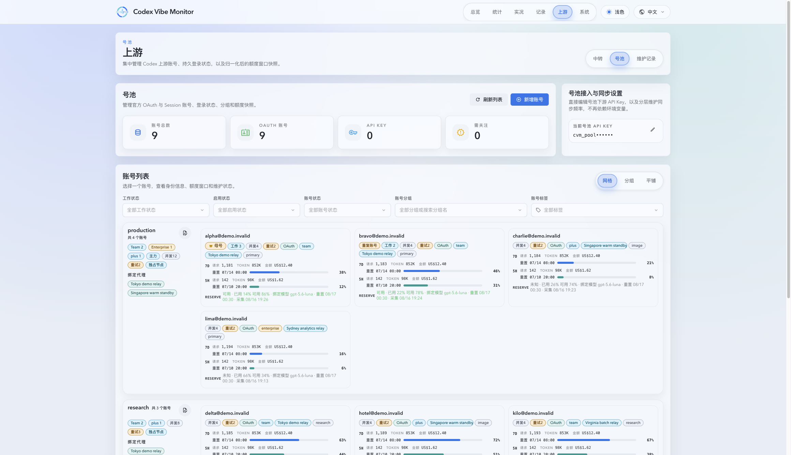
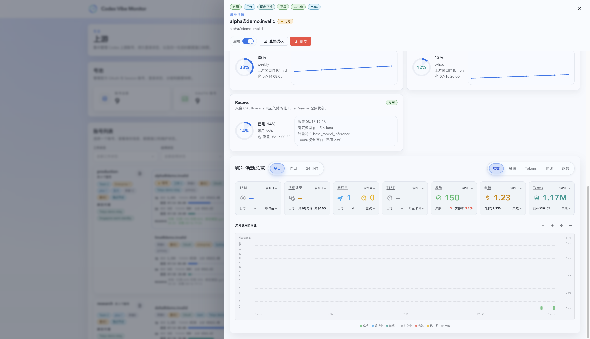
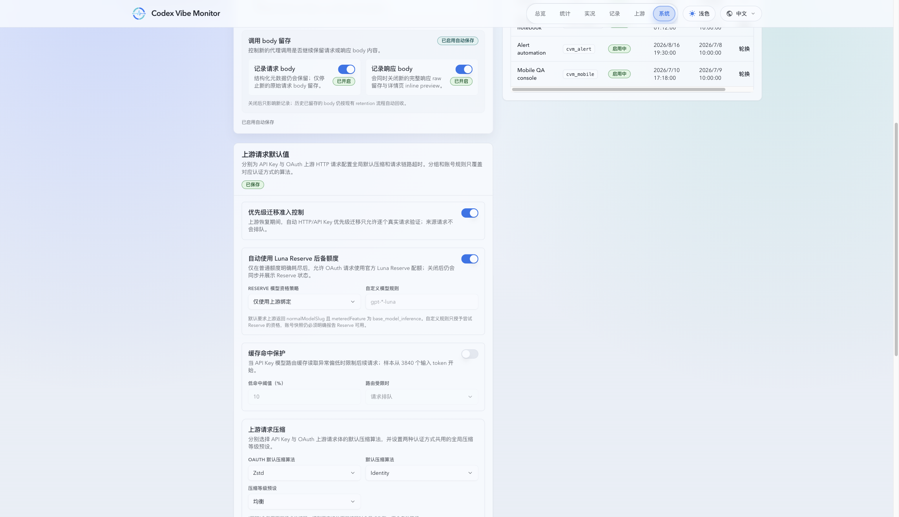

# OAuth Luna Reserve fallback

## Context and Scope

OAuth Codex usage responses can expose an additional structured limit for subscription accounts. The service needs to retain that signal as a separate quota capability and use it only under an explicit, operator-controlled fallback policy.

This topic covers the typed Reserve usage snapshot, additive SQLite persistence, OAuth account-pool routing, request observability, the automatic fallback setting, and the account-pool UI. It does not change ordinary quota accounting or make arbitrary `gpt-*-luna` models aliases for Reserve.

## Goals / Non-goals

### Goals

- Identify the upstream capability as **Luna Reserve**, its allowance as **Reserve Quota**, and its upstream wire model as `gpt-reserve`.
- Parse structured `additional_rate_limits` data in both object and array forms and retain a typed, freshness-aware Reserve snapshot.
- Route ordinary requests to Normal Quota first, then use Reserve only after a classified ordinary-quota exhaustion when automatic fallback is enabled.
- Keep explicit `gpt-reserve` requests Reserve-only and preserve the client-requested model identity in diagnostics.
- Expose Reserve availability, reported percentages, reset time, capture time, route, wire model, and fallback reason without fabricating an absolute balance.

### Non-goals

- Mapping every model containing `luna` to `gpt-reserve`.
- Advertising `gpt-reserve` in the ordinary public model catalog.
- Inferring Reserve availability from price, local token usage, or upsell text.
- Adding Reserve history charts or changing the ordinary quota window's statistics.

## Requirements

### MUST

- REQ-RESERVE-001: Missing, stale, or failed Reserve observations are `unknown`; they cannot authorize automatic fallback and must not be treated as `unavailable`.
- REQ-RESERVE-002: The automatic fallback switch defaults to enabled for OAuth routing, can be disabled globally, and does not disable usage synchronization or Reserve visibility.
- REQ-RESERVE-003: Automatic fallback requires a clear ordinary-quota exhaustion signal, refreshes usage at most once, and reuses the existing failover budget.
- REQ-RESERVE-004: Generic 429, 5xx, authentication, parameter, unsupported-model, and unknown failures do not trigger automatic Reserve fallback.
- REQ-RESERVE-005: A single Reserve failure does not mark Reserve exhausted without an explicit upstream signal or confirming usage snapshot.
- REQ-RESERVE-006: SQLite changes are additive and preserve existing databases and older usage snapshots.
- REQ-RESERVE-007: Account list/detail API responses distinguish `available`, `unavailable`, and `unknown` and do not expose or derive an absolute remaining balance.
- REQ-RESERVE-008: Automatic Reserve fallback requires an eligible effective request model. The default `upstream` policy requires an `additional_rate_limits` binding with `normal_model_slug` matching the effective model and `metered_feature=base_model_inference`; incomplete bindings fail closed.
- REQ-RESERVE-009: The Reserve model policy supports `upstream`, `upstream_plus_custom`, and `custom` modes with bounded exact/glob patterns. Explicit `gpt-reserve` requests remain Reserve-only and bypass automatic model-eligibility filtering.

## Functional Behavior

### Usage snapshot

The OAuth usage parser accepts `additional_rate_limits` as either a keyed object or an array of limit records. The Reserve record stores its window, reported percentage, reset time, availability state, source, and capture time. A snapshot is usable only while its structured data is fresh and explicitly available.

### Routing

Normal requests select Normal Quota first. After classified ordinary-quota exhaustion, the router may retry the current account with `gpt-reserve` and then select another Reserve-available OAuth account within the existing failover budget. The request's client model remains the original model; request diagnostics record `quota_route=reserve`, the Reserve wire model, and the fallback reason.

An explicit `gpt-reserve` request selects Reserve only and never downgrades to Normal Quota. Turning off automatic fallback prevents only the implicit route transition.

Automatic fallback uses the effective model after the existing account model mapping has been resolved. By default, the account's fresh Reserve snapshot must bind that model through `normal_model_slug` and `metered_feature=base_model_inference` in `additional_rate_limits`. Administrators may choose `upstream_plus_custom` or `custom` to add bounded exact/glob model patterns; these settings only control eligibility and do not rewrite the client model.

### Operator surfaces

Pool routing settings expose `automaticReserveFallbackEnabled` and `reserveFallbackModelPolicy` (`upstream`, `upstream_plus_custom`, or `custom`, with bounded exact/glob patterns). OAuth account summaries and details expose Reserve availability, usage percentage, available percentage when reported, reset time, and last capture time. `unknown` and `unavailable` have separate labels and visual states.

## Interfaces

| Interface                        | Change                                                                 | Consumers                                           |
| -------------------------------- | ---------------------------------------------------------------------- | --------------------------------------------------- |
| OAuth usage snapshot             | Add typed Reserve fields and object/array parsing                      | usage sync, SQLite persistence, candidate selection |
| Pool routing settings API        | Add `automaticReserveFallbackEnabled` and `reserveFallbackModelPolicy` | settings page, routing policy                       |
| OAuth account summary/detail API | Add Reserve status and reported window fields                          | account list and detail views                       |
| Pool request diagnostics         | Add quota route, Reserve wire model, and fallback reason               | invocation records and troubleshooting              |

## Verification

- VER-RESERVE-001: `cargo test reserve_usage_snapshot -- --nocapture` covers object and array parsing. covers: REQ-RESERVE-001, REQ-RESERVE-006
- VER-RESERVE-002: `cargo test reserve_routing -- --nocapture` covers fresh availability, ordinary-first routing, and same-account fallback with the Reserve wire model. The fallback switch and failure classification are covered by `cargo test automatic_reserve_fallback_requires_explicit_normal_quota_exhaustion -- --nocapture`. covers: REQ-RESERVE-001, REQ-RESERVE-002, REQ-RESERVE-003, REQ-RESERVE-004, REQ-RESERVE-005
- VER-RESERVE-003: `cargo test reserve_request_rewrite -- --nocapture` covers client model preservation and `gpt-reserve` wire rewriting. covers: REQ-RESERVE-003, REQ-RESERVE-004, REQ-RESERVE-009
- VER-RESERVE-007: `cargo test reserve_routing -- --nocapture` covers upstream model binding, custom model patterns, and the effective-model eligibility gate. covers: REQ-RESERVE-008, REQ-RESERVE-009
- VER-RESERVE-008: `cargo test pricing_catalog_and_models_passthrough -- --nocapture` covers the default switch and persisted custom model policy; `cargo test reserve_routing_requires_upstream_model_binding_or_explicit_custom_pattern -- --nocapture` covers the effective-model eligibility rule. Explicit `gpt-reserve` remains Reserve-only through the route guard and request rewrite tests. covers: REQ-RESERVE-002, REQ-RESERVE-008, REQ-RESERVE-009
- VER-RESERVE-004: `cargo fmt --all -- --check`, `cargo check --locked --all-targets --all-features`, and `cargo clippy --locked --all-targets --all-features -- -D warnings` pass locally. covers: REQ-RESERVE-006
- VER-RESERVE-005: `bash .github/scripts/run-backend-tests.sh --profile stateful-sqlite` passes the profile's reported stateful test set plus the schema-template precheck. covers: REQ-RESERVE-001, REQ-RESERVE-006
- VER-RESERVE-006: `cd web && bun run test`, `bun run typecheck:web`, and `bun run build` pass; the Web App Demo provides account-list, account-detail, and settings toggle plus Reserve model policy mode/pattern visual evidence. covers: REQ-RESERVE-002, REQ-RESERVE-007, REQ-RESERVE-009

## Visual Evidence

The following screenshots were captured from the Web App Demo (`VITE_APP_RUNTIME=demo`) at a 2320x1335 browser viewport. Each evidence record binds the target program, runtime, route, browser viewport, and the source/capture revision used for the screenshot.

- source_type: ui_demo
  target_program: Web App Demo
  runtime: `VITE_APP_RUNTIME=demo`
  route: `/#/account-pool/pool`
  requested_viewport: 2320x1335
  capture_scope: browser-viewport
  source_revision: `9fd5ae4b8cff3cc8752c4d81b6c342c10c22176a`
  capture_revision: `9fd5ae4b8cff3cc8752c4d81b6c342c10c22176a`

- source_type: ui_demo
  target_program: Web App Demo
  runtime: `VITE_APP_RUNTIME=demo`
  route: `/#/account-pool/pool?upstreamAccountId=101`
  requested_viewport: 2320x1335
  capture_scope: browser-viewport
  source_revision: `9fd5ae4b8cff3cc8752c4d81b6c342c10c22176a`
  capture_revision: `9fd5ae4b8cff3cc8752c4d81b6c342c10c22176a`

- source_type: ui_demo
  target_program: Web App Demo
  runtime: `VITE_APP_RUNTIME=demo`
  route: `/#/system/settings`
  requested_viewport: 2320x1335
  capture_scope: browser-viewport
  source_revision: `9fd5ae4b8cff3cc8752c4d81b6c342c10c22176a`
  capture_revision: `9fd5ae4b8cff3cc8752c4d81b6c342c10c22176a`

## Related ADRs

- [ADR 0051: OAuth Luna Reserve fallback routing](../../adr/0051-oauth-luna-reserve-fallback.md)
