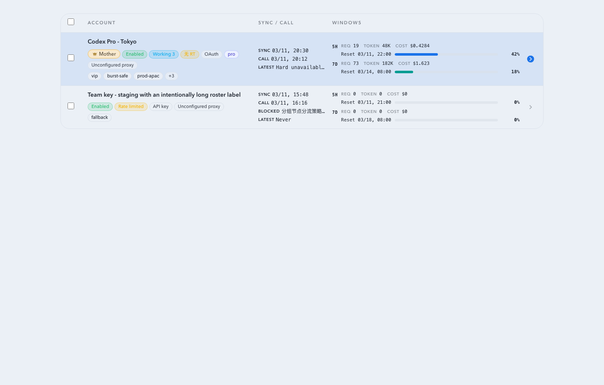
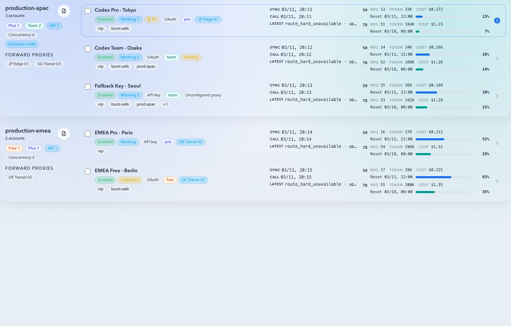
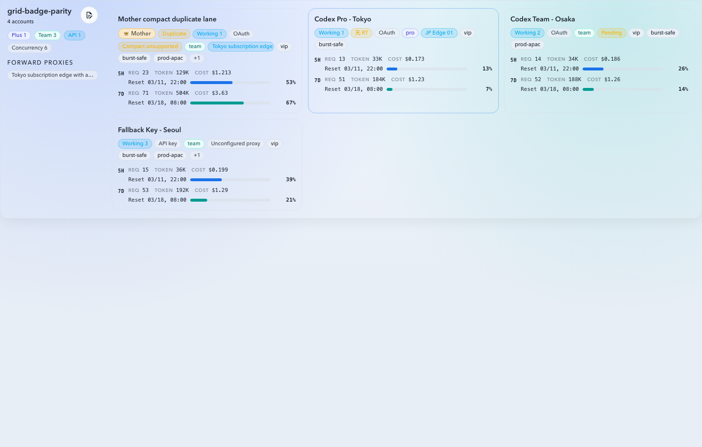
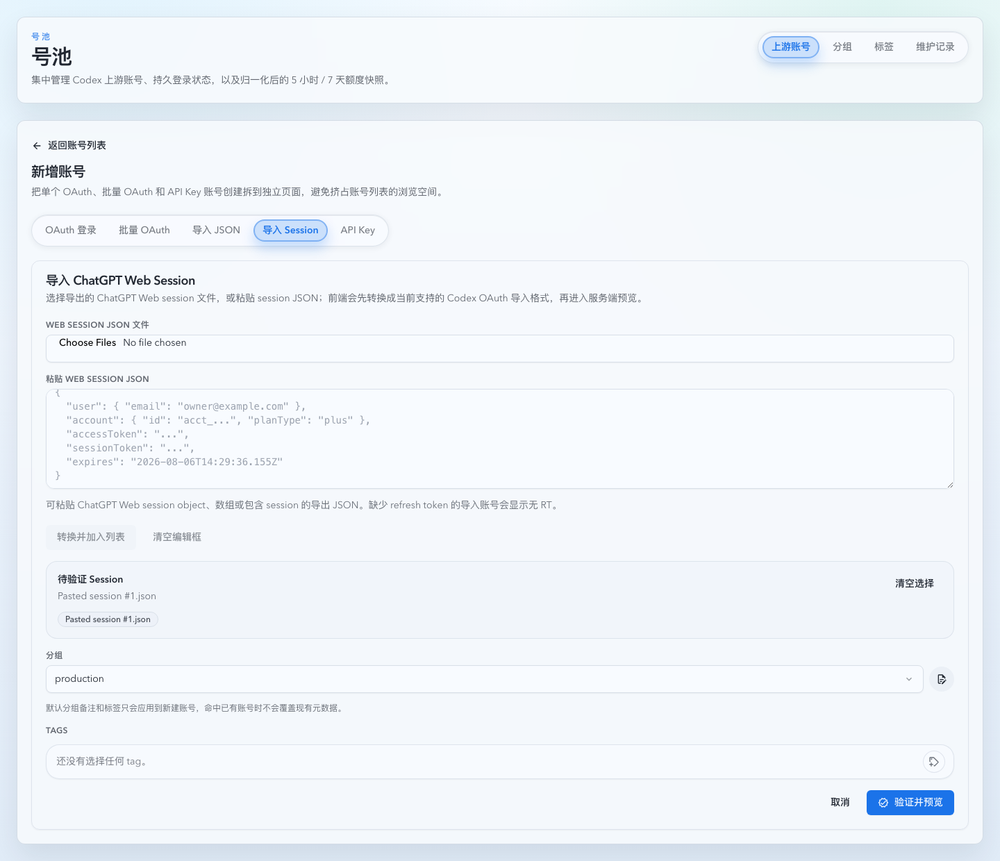
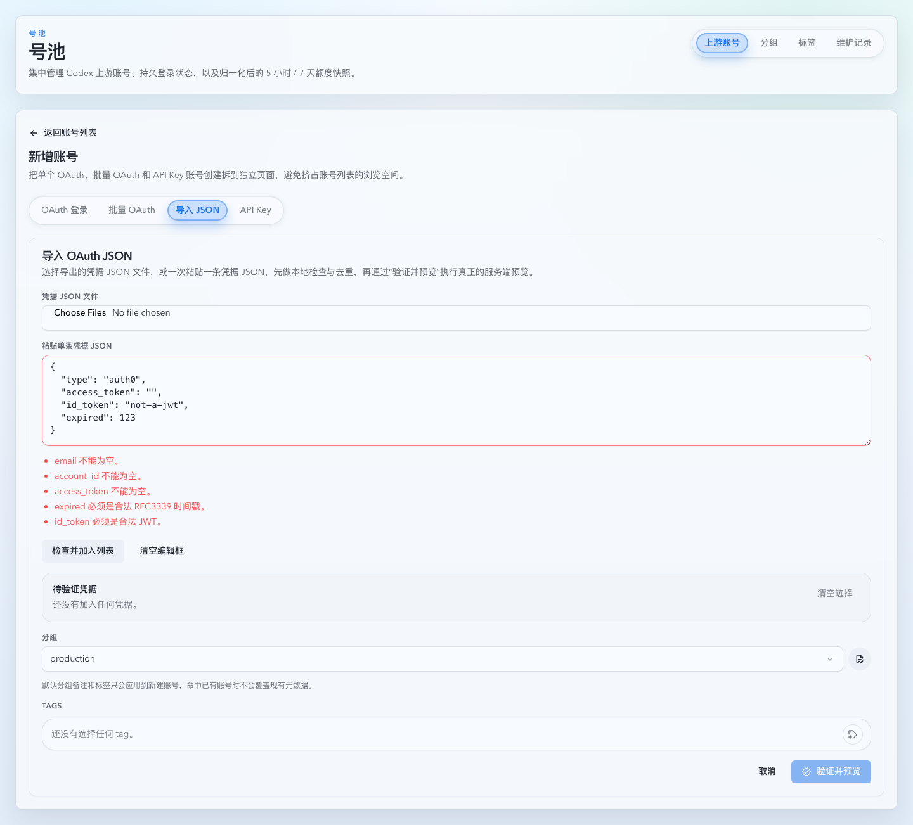
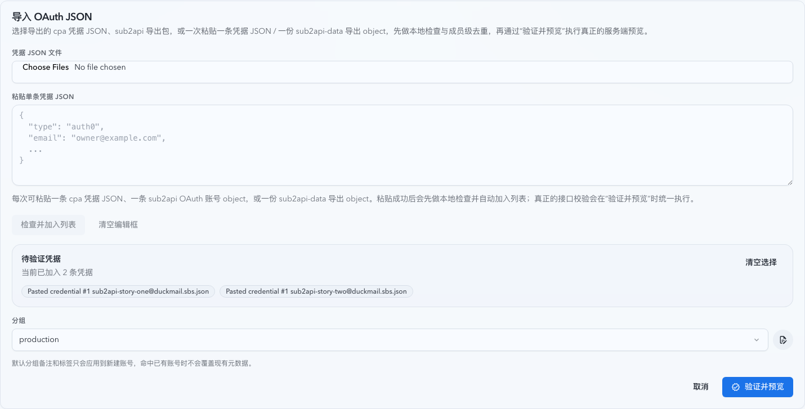
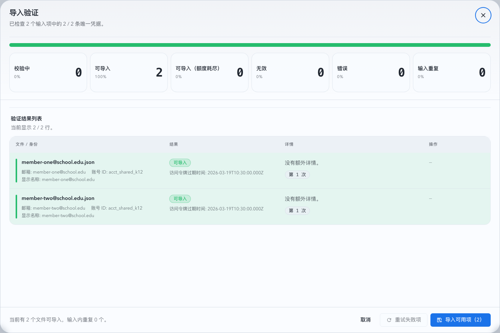

# OAuth 数据面内联合并（#pd77h）

## Context and Scope

本主题涵盖主进程内 OAuth 数据面和既有 OAuth 导入通路；sub2api 兼容范围限定为 OpenAI OAuth 单记录与官方导出包，不迁移 API Key、其他平台或代理调度配置。

- 当前 OAuth 数据面通过固定 sidecar `ai-openai-oauth-bridge` 提供 `/openai/v1/*` 兼容层，主服务在 pool 路由前还要额外走一次内部 token register。
- 这一层抽象没有给本项目带来可复用收益，却把部署从单服务抬成了双进程/双容器，现网已经出现“重新授权成功，但因 sidecar 未启动而被重新打成异常”的故障。
- 主服务与 sidecar 实际上都在同一仓库、同一镜像里，继续保留自调用 HTTP 边界只会增加错误面、文档复杂度和排障成本。

## 目标 / 非目标

### Goals

- 把 OAuth Codex 数据面适配逻辑内联到主进程，删除 sidecar 生命周期、内部 register/token_key 语义与固定服务名依赖。
- 保持对外 `/api/pool/*`、`/v1/*` 访问方式稳定，避免影响现有前端和下游客户端。
- 把 pool 路由成功响应抽象升级为传输无关形态，使 API Key 直连和 OAuth 内联都能走同一消费链。
- 保留当前 OAuth refresh / usage sync / 显式失效转 `needs_reauth` 的规则，不把 bridge 故障语义继续带入新实现。

### Non-goals

- 不新增新的 OAuth provider、账号级 OAuth 数据面配置项或用户侧 env。
- 不改变 API Key 账号的 upstream 覆盖逻辑、pool 选路策略与 forward proxy 通路。
- 不保留 `openai-oauth-bridge` 兼容入口或过渡版本。

## 范围（Scope）

### In scope

- 主进程内 OAuth Codex adapter 与 pool 内部响应抽象重构。
- 删除 sidecar 二进制、镜像双入口和相关部署/排障文案。
- 同步 Rust / Web / docs / tests，使“单服务 OAuth 数据面”成为唯一口径。

### Out of scope

- 改写 OpenAI pool API 对外 wire shape。
- 新增与本次内联无关的权限模型、限流策略或 UI 功能。

## Requirements

### MUST

- OAuth pool 路由不得再访问 `http://ai-openai-oauth-bridge:3000/internal/token/register` 或 `http://ai-openai-oauth-bridge:3000/openai`。
- `PoolResolvedAccount` 与 pool 请求发送链路必须能显式区分 API Key 直连与 OAuth 内联执行，不能再把 OAuth 伪装成“Bearer bridge token + 本地 HTTP upstream”。
- pool 成功响应必须升级为传输无关的统一抽象，能够同时承载 reqwest 上游响应与主进程内构造的 OAuth adapter 响应。
- OAuth `/v1/models`、`/v1/responses`、`/v1/responses/compact`、`/v1/chat/completions` 的兼容行为必须保留：模型列表归一化、非 stream `/responses` 的 SSE 收敛、stream passthrough 与错误摘要规则都不能回退。
- 只有 refresh/token 明确失效时才能把账号标成 `needs_reauth`；数据面可用性/权限/上游拒绝必须落 `error`，且不再写入 bridge register 相关错误。
- Docker 镜像与部署文档必须回到单服务口径，只保留 `codex-vibe-monitor` 可执行文件。

### SHOULD

- 历史 bridge 错误字符串在 UI 详情里允许继续只读展示，直到该账号下一次同步或路由结果覆盖为止。
- 内联后的 OAuth adapter 测试注入点应尽量复用现有本地 test server 模式，避免整体重写测试夹具。

- REQ-SUB2API-01: 必须识别无格式标记及历史标记的导出包，仅导入 OpenAI OAuth，逐条报告不支持记录。
- REQ-SUB2API-02: sub2api OAuth 不得强制要求 ID token；必须从导出字段或 token 确定必要身份及有效期，保留成员身份并拒绝冲突，不改变凭据存储结构。

## 功能与行为规格（Functional/Behavior Spec）

### Core flows

- OAuth 账号同步：仍先刷新 access token、再抓 usage snapshot；该流程不依赖任何本地 sidecar。
- OAuth 账号允许没有 refresh token。导入 JSON、外部 upsert/relogin 与 OAuth callback 中的 `refresh_token` 缺失、`null`、空白字符串都按“无 RT”持久化；自动刷新分支在无 RT 时跳过 token endpoint，继续用现有 access token 尝试 usage 或数据面请求，过期后的上游失败沿用现有错误分类。
- OAuth JSON 导入不把 `type` 当作来源白名单；`type` 缺失、空白或非 `codex` 字符串不阻断导入。单条粘贴/单文件本地校验一次性展示可并行发现的多个字段错误，避免逐项修复才暴露下一条错误。
- 新增账号页提供 `导入 Session` 入口。前端把 ChatGPT Web session JSON 中的 `accessToken`、`sessionToken`、`user.email`、`account.id`、`account.planType`、`expires` 等字段转换成现有 Codex OAuth 导入 JSON；缺少 `id_token` 时仅合成本项目 claims 解析需要的 unsigned JWT，缺少 `refresh_token` 时按无 RT 账号导入。
- OAuth JSON 导入支持 sub2api 单账号记录，以及包含 `accounts` 数组的官方导出包；包顶层 `type` 可省略或为空，也兼容 `sub2api-data`、`sub2api-bundle` 标记。导出包在本地按成员展开；仅接收 `platform=openai` 且 `type=oauth` 的账号，API Key 与其他平台逐条报告跳过原因，不迁移包内代理或调度配置。
- sub2api OAuth 记录不强制提供 `id_token` 或 `refresh_token`。邮箱、账号 ID、成员 ID 与套餐优先取非空导出字段，再从已有 ID token、access token 的身份声明补齐；邮箱、账号 ID 与 access token 仍必须可确定，成员 ID 与套餐可缺省。显式字段或两个 token 之间的邮箱、账号 ID、成员 ID 冲突必须拒绝，不可静默覆盖；已存在但类型错误的身份声明也必须拒绝，不得被显式字段静默掩盖。
- sub2api 的 token 有效期支持 `credentials.expires_at`、`credentials.expired` 与兼容的顶层 `expired`，接受 RFC3339 或 Unix 秒/毫秒；缺省时优先使用 `access_token.exp`，其次使用 `id_token.exp`。无效显式时间或无法确定有效期时拒绝，不得使用账号级 `expires_at`、导出时间或虚构默认期限补齐。
- 缺少 ID token 的 sub2api 记录在身份和有效期完整时沿用 Session 的合成身份载体，进入既有真实服务端验证与导入流程；该载体只适配现有持久化格式，不替代 access token 授权或验活。前后端单账号解析必须保持相同归一化规则，显式成员 ID 不得因原 ID token 未携带该字段而丢失。
- 缺少成员 ID 的导入记录只允许匹配同样缺少成员 ID 的历史账号；批内去重在无成员 ID 时同时使用账号 ID 与邮箱，避免共享账号下不同成员互相覆盖或被丢弃。
- OAuth pool 路由：主进程直接根据请求路径调用内联 adapter，adapter 使用当前 access token 调用 `https://chatgpt.com/backend-api/codex` 并产出 OpenAI-compatible 响应。
- API Key pool 路由：继续使用现有 `OPENAI_UPSTREAM_BASE_URL` / 账号级 `upstreamBaseUrl` 直连 reqwest 请求路径。
- pool 消费链：不再要求上游一定是 `reqwest::Response`；统一从“状态码 + headers + body stream”抽象读取首包、透传 headers、记录 timings 与错误。

### Edge cases / errors

- OAuth 数据面返回明确 `invalid_grant` / token invalidated / must sign in again：账号转 `needs_reauth`。
- OAuth 数据面返回普通 `401/403/5xx/429`、结构化错误或 transport 失败：账号转 `error`，保留可诊断错误摘要。
- 非 stream `/v1/responses` 若上游 SSE 没有 `response.completed` 或出现 `response.failed`：按现有错误摘要规则返回 `error`。
- 大 body 或 live body replay 路径下，OAuth 请求允许先等待 replay snapshot 完整后再进入内联 adapter，不要求保留旧 sidecar 的“边读边转发”假象。

## 接口契约（Interfaces & Contracts）

### 接口清单（Inventory）

| 接口（Name）                                   | 类型（Kind） | 范围（Scope） | 变更（Change） | 契约文档（Contract Doc） | 负责人（Owner） | 使用方（Consumers） | 备注（Notes）                               |
| ---------------------------------------------- | ------------ | ------------- | -------------- | ------------------------ | --------------- | ------------------- | ------------------------------------------- |
| `/api/pool/upstream-accounts*`                 | HTTP API     | external      | Modify         | None                     | backend         | web                 | 仅错误口径与文案变化，对外路径不变          |
| `/v1/*` pool routing                           | HTTP API     | external      | Modify         | None                     | backend         | downstream clients  | 对外路径不变，内部执行形态改为单进程        |
| `PoolResolvedAccount` / pool upstream response | internal     | internal      | Modify         | None                     | backend         | proxy / pool router | 明确 transport 分流并去除 reqwest-only 假设 |

### 契约文档（按 Kind 拆分）

None

## Verification

- Given 单服务部署的新版本
  When 只运行 `codex-vibe-monitor`
  Then OAuth 账号同步和 `/v1/*` pool 路由都可工作，仓库文档不再要求 `ai-openai-oauth-bridge`。

- Given OAuth 账号重新授权成功
  When 后续被真实 `/v1/responses` 请求选中
  Then 不会再因为内部 register 端点不可达而进入 `error`，且 `last_error` 不再出现 `failed to contact oauth bridge token register endpoint`。

- Given API Key 与 OAuth 账号混合在 pool 中
  When 请求经过 pool failover / sticky / replay 流程
  Then API Key 路径行为保持不变，OAuth 路径通过内联 adapter 返回兼容响应，统一消费链记录 timings 与错误。

- Given OAuth 数据面出现明确 refresh/token 失效
  When 请求或同步触发该失效
  Then 账号状态仍会转成 `needs_reauth`，而不是模糊地写成普通 `error`。

- Given OAuth 凭据没有 refresh token
  When 同步、维护探测或 pool 路由候选加载需要 refresh-before-use 或 retry-after-401
  Then 服务不请求 OAuth token endpoint，仍允许当前 access token 先参与 usage 或数据面请求，并在账号列表 API 返回 `hasRefreshToken=false` 供 Web 标记 `无 RT`。

- Given OAuth 导入 JSON 的 `type` 是 `auth0`、空白或缺失
  When 用户粘贴或选择该凭据 JSON
  Then 本地校验与服务端预览不会返回 `type must be codex`。

- Given 单条 OAuth 导入 JSON 同时缺少多个必填字段
  When 用户在导入页触发本地校验
  Then 页面一次性展示多个字段错误，而不是每次只展示第一条错误。

- Given 用户粘贴 ChatGPT Web session JSON
  When 其中包含 `accessToken`、账号邮箱、账号 id 和过期时间
  Then `导入 Session` 会把它加入现有 OAuth 导入队列，并通过同一个服务端预览/导入流程落库。

- VER-SUB2API-01 (covers: REQ-SUB2API-01): Given sub2api 官方导出包缺少顶层 `type`，且包含两个共享工作区但成员 ID 不同的 OpenAI OAuth 账号和一个 API Key 账号
  When 用户选择文件或粘贴导出包
  Then 两个 OAuth 成员分别入队，API Key 逐条提示跳过，不出现整包缺少顶层凭据字段的误报。

- VER-SUB2API-02 (covers: REQ-SUB2API-02): Given sub2api OAuth 记录没有 ID token，但导出字段或 access token 能提供必要身份和 token 有效期
  When 前端本地检查或服务端单记录归一化执行
  Then 记录可以进入既有验活流程，并保留成员 ID、套餐和无 RT 状态；缺失必要身份、有效期或存在身份冲突的记录明确拒绝。

## Visual Evidence

## 方案概述（Approach, high-level）

- 复用现有 `src/oauth_bridge.rs` 的数据面适配逻辑，但删除 server/register 生命周期，只保留“直接拿 access token 调 codex backend 并生成兼容响应”的能力。
- pool 路由在账号解析阶段显式区分 API Key 与 OAuth，两条路径在成功后统一收敛到传输无关响应抽象。
- 保持现有 refresh/sync/状态机规则，只删除 sidecar 专属缓存与恢复分支。

## 风险 / 开放问题 / 假设（Risks, Open Questions, Assumptions）

- 风险：pool live body replay 路径在 OAuth 内联后需要完整 snapshot 才能改写 `/responses` 请求。
- 风险：统一响应抽象涉及 proxy capture / stream 转发链，若改动不完整容易造成首包或 header 透传回归。
- 假设（需主人确认）：本次允许删除 `openai-oauth-bridge` 二进制与全部 sidecar 文档，不保留兼容入口。

## 参考（References）

- `docs/specs/u8j4n-fixed-oauth-bridge-sidecar/SPEC.md`
- `src/oauth_bridge.rs`
- `src/upstream_accounts/mod.rs`
- `src/main.rs`

## Related ADRs

None
