# 外部性能观测与旧性能库退役

## 状态

- Status: active
- Owner-facing surface: Grafana dashboards and application observability entry

## Context and Scope

数据库竞争、CPU 异常与响应慢需要跨层指标、代码归因和按需 CPU 调用栈。Prometheus 独占聚合指标历史，Grafana 负责图表与告警，hotpath-rs 提供进程内诊断；应用只维护有界内存累计和入口。业务主库、任务库、TerminalJournal、raw/archive 与调用明细仍是原有业务事实源。

## Requirements

- REQ-001: 应用不得创建、打开或写入旧性能 SQLite；旧 collector、writer、time bucket、rollup 和历史查询全部退役。 covers: [ADR 0025](../../adr/0025-external-performance-observability.md)
- REQ-002: 合法配置下采样器、exporter、hotpath、Prometheus 或 Grafana 故障只使观测降级，不阻断代理、终态 ACK、任务与业务健康。测试实例必须使用独立 recorder。 covers: [锁定架构](../../design/performance-observability.md#应用模块与真实接入点)
- REQ-003: 仅导出固定指标和白名单标签，不含账号、模型、用户、IP、原始 URL、请求身份、payload、SQL 参数或 raw SQL logs。规范化 SQL 和函数诊断条目必须有运行时上限。 covers: [指标合同](../../design/performance-observability.md#指标合同)
- REQ-003A: 单实例初始系列预算为 5000，hotpath 动态条目上限为 100；溢出归并或收窄导出，不自动放宽。 covers: [指标合同](../../design/performance-observability.md#指标合同)
- REQ-004: Counter 为进程累计，Gauge 为当前读数，时间统一秒、容量统一字节。SDK 使用显式 classic Histogram buckets，hotpath 使用 native Histogram；缺测、重启、真实零与低样本须可区分。 covers: [指标迁移](METRICS.md)
- REQ-005: 私网抓取间隔为 15 秒，在线保留默认 30 天且受容量清理约束；旧历史只离线归档 90 天，不转换或回填。 covers: [ADR 0025](../../adr/0025-external-performance-observability.md)
- REQ-006: 热路径只累计有界内存；CPU 每 5 秒、内存和已知文件 metadata 每 30 秒采样，不扫描主库或遍历 raw/archive。 covers: [指标合同](../../design/performance-observability.md#指标合同)
- REQ-007: 应用能力接口不查询外部历史或暴露凭据；私网 scrape 与独立只读诊断使用不同凭据。hotpath API 限定三个固定报告、100 行、1 MiB、2 秒与全局每分钟 30 次，禁止任意 URL、路径、PID 或控制操作。 covers: [接口合同](../../design/performance-observability.md#hotpath-与应用-api)
- REQ-008: 浏览器仅固定页面族和设备档，最多 8 样本/2 KiB、每页约 60 秒一批；服务端固定 60 秒窗口内全局 120 次、客户端 30 次，客户端身份由现有反向代理覆盖传入的 `X-Real-IP`，应用端口禁止公网直达。同源校验与有界拒绝生效，上报失败不持久重试；实际 data-ready/paint/API/SSE 来源和采集质量不得伪造零。 covers: [浏览器合同](../../design/performance-observability.md#浏览器与应用页面)
- REQ-009: 应用仅提供 Grafana 入口及固定 UID/变量/UTC 窗口深链接，不 iframe 或复制图表。旧 API 一个迁移 major 内仅返回 410；任务旧 performance 字段移除，业务 ModelPerformanceDetails 保留。 covers: [退役合同](../../design/performance-observability.md#旧系统一次性退役与恢复)
- REQ-010: 请求头与完整 body 生命周期分开；一次 invocation 在规范去重边界计一次，upstream attempt 和重试独立；coordinator、pool、queue、SQL execution、ACK 与 enqueue-to-commit 为真实来源窗口，不把均值当样本。 covers: [指标迁移](METRICS.md)
- REQ-011: SQLx tracing 不受全局日志过滤，最终 router 仅安装一次 hotpath layer；函数默认 10% 抽样并显示样本数，SQL/锁及关键 SDK 指标完整观测。 covers: [hotpath 合同](../../design/performance-observability.md#hotpath-与应用-api)
- REQ-012: 正式 Grafana dashboard、datasource UID、变量、规则和告警从版本控制 provision；无样本分位数为空，平台不支持和外部连通性未检查保持 unknown。 covers: [仪表盘合同](../../design/performance-observability.md#仪表盘告警和留存)
- REQ-012A: 六个固定 dashboard 按“发现异常 → 分类 → 定位原因 → 查看证据”组织；总览默认业务 endpoint，读数/趋势/归因遵守 24 列和窄屏顺序，Stat/Time series/横向条形图/Table 使用固定颜色、单位、样本数与中文说明，高级说明可折叠并通过保留时间/实例的 dashboard links 下钻。窗口计数使用 `increase`、速率使用 `rate`，经典 Histogram 先合并 bucket 后算分位数，hotpath 只使用 native Histogram；表格查询整个所选窗口，缺测、零值、低样本和过期读数保持可区分。 covers: [仪表盘布局与查询合同](../../design/performance-observability.md#仪表盘布局与查询合同)
- REQ-013: 人类通过公网 HTTPS 与交互认证访问 Grafana，Agent 用独立 Viewer Token 经 HTTPS 查询，无需 SSH 或直连 Prometheus；入口只为必要机器路径跳过交互挑战且仍验证 Token，拒绝缺失/错误 Token 与写请求。机器 Token 必须来自 regular file，权限只允许 owner access 与可选 group read（例如 0600/0640），拒绝 group write/execute 及所有 other-user bits。 covers: [访问合同](../../design/performance-observability.md#101-服务访问和权限)
- REQ-014: SSH 仅用于本项目 hotpath 与 CPU 诊断；CPU 对运行实例 attach，默认 100 Hz/30 秒、上限 60 秒、单实例单并发，符号必须匹配 build ID，产物保留 7 天/512 MiB，不新增 daemon 或任意 PID/root shell。 covers: [CPU 合同](../../design/performance-observability.md#cpu-采样与-ssh-运维合同)
- REQ-015: 本次退役限定 v3→v4，核验固定 digest 的 v3 镜像与停止 writer 的身份，拒绝 v2 直接跨 major 及 v4 来源。须精确核验文件身份与前一 major 的完整 schema-v1 DDL，包含默认值、表约束与索引，仅忽略格式和注释；停旧 writer 后含 WAL 一致归档并校验，再移出应用挂载。未知归属、DDL 或备份失败保留源。阶段清单可重入，中断用前向恢复，恢复备份是独立灾难恢复操作。 covers: [退役合同](../../design/performance-observability.md#旧系统一次性退役与恢复)
- REQ-016: 性能 A/B 必须由 GitHub Actions 的 GitHub-hosted runner 完成，生产镜像构建与测量使用不同 job。三轮实验在三台隔离 runner 并行执行，每轮在同一 runner 串行运行同一候选镜像的 off、metrics-only、metrics＋trace 三种模式，轮换模式顺序；功能与 CPU attach 在第四台 runner 并行验证。每窗口 60 秒预热、60 秒测量、5 req/s，必须完成 300/300 请求；九个窗口全部齐备才能比较。三台配对 runner 的单一 CPU 型号、核心数、内核、runner 镜像及镜像版本必须逐项相同，增量按同机配对比值的中位数计算，不跨机器配对；三组原始窗口及配对比值的 CV 均不得超过 5%，CPU 每完成请求及成功请求 p95 增幅均不得超过 5%。短窗口样本不足或不稳定只能报告未验证，不能降低门槛。性能实验只接受默认分支控制的 `pull_request_target` 显式标签事件，脚本来自 base checkout，候选代码只作为隔离镜像运行；证据绑定 candidate SHA、镜像 ID、合同及场景 digest、run/attempt，任意新提交使旧卡失效。性能实验不成为普通 Build Artifacts 的依赖；本地或共享测试机结果不能签发预算通过卡。 covers: [验收合同](../../design/performance-observability.md#验收与实施交接)
- REQ-016A: 性能测试阶段共享同一个起始时刻，包含 checkout、镜像下载装载、准备、预热、准入、测量和清理，硬上限 15 分钟，不按分支或重试重置。脚本在第 14 分钟中断运行并保留清理和上传时间，各测试 job 另有 15 分钟硬超时；最终合并验证超出共享 15 分钟不得签发通过卡。镜像构建独立计时并设 15 分钟上限，不把构建耗时算作已完成的测试。每个测量窗口在预热后按 20 秒间隔取得连续三次安静样本，PSI `some avg10/avg60` 阈值保持 CPU <2%、IO <5%、memory <0.1%，每窗口最多等待 180 秒、每轮三窗口累计最多 450 秒，同时受共享总时限约束；不再重复执行初始静默等待。正式窗口记录开关、配对编号、UTC/单调起止、初末边界及每 10 秒资源样本；首次测量前一次性固定 app 与辅助容器的容器 ID、PID 起始 tick、cgroup v2 路径和有效 affinity，并要求每个 PID 的实际 cgroup 路径对应其 Docker 容器身份；首个 CPU 归因样本显式标记 `counterDeltaStatus=baseline` 且不填充 delta，后续样本必须记录实际 counter delta；验证器拒绝缺失、负值、字段不完整或 CPU 集合不一致的 delta，按相邻原始 host/app 计数器重算并逐样本核对，窗口汇总 delta 必须与首尾样本重算结果一致；验证器还必须逐样本校验 app `cpu.pressure` 的完整数值结构，并在准备阶段独立核对每个 cgroup 路径与容器 ID 的对应关系；在每个样本记录 runner 允许 CPU 的 `/proc/stat`、app cgroup 的 `cpu.stat`/`cpu.pressure`/`cpu.max` 与进程状态，保留 host/app counter delta，且每个样本的 app `cpu.max` 必须等于准备阶段的一核配额，准备记录与每个原始样本逐服务交叉校验。首样本未满足准入、缺失/非法、采集错误、PID 替换、计数器回退、配额变化、cgroup/CPU 归因不支持或间隔超过 20 秒记为 unavailable，不用零值填充或从 wall time 推断根因。负载期间超阈值保留原始 PSI 与 `pressureExceededSamples`，不伪装成采集故障。应用固定一个 CPU，辅助容器使用 runner 默认 affinity；按模式启停必需服务，Grafana 在正式窗口始终停止。缺失分支、超时、身份或硬件不匹配、积压、trace 丢失均不能通过，不自动延时、重跑或筛选窗口。 covers: [验收合同](../../design/performance-observability.md#验收与实施交接)
- REQ-016B: `cpu.stat` 解析器必须接受 Linux 合法的未来字段名，包括由小写字母、数字和下划线组成、以点分隔且每段至少一个字符的命名空间，同时继续要求六个必需计数器、非负整数、无重复键和 16 KiB 文件上限；进程/cgroup 身份、有效 CPU 集合和计数器回退校验保持不变。
- REQ-016C: CPU 归因准备失败必须写入有界且固定枚举的 `stage`、`source`、`reason` 诊断；不得写入原始异常文本、路径、环境变量、业务数据或未授权字段。准备失败必须独立保留为 unavailable，并在 observer 尚未启动时仍尽力写入白名单证据。
- REQ-016D: 汇总器必须独立保留已验证的 runtime 场景、A/B pair 场景和硬件兼容性结论；硬件不匹配只能使经验性结论 unavailable，不得删除已验证 runtime 结果、池化不可比较样本，或把功能失败、准备失败和硬件错误改写为通过。
- REQ-016E: GitHub-hosted 的 `ubuntu-24.04` 标签不等价于物理硬件一致性；正式比较仍须逐项核对 CPU 型号、核心数、内核、runner 镜像及版本。低成本资源 preflight 只能作为未来的准入/成本门，不得放宽五字段合同；付费 runner、外部资源或统计合同变更须另行作出明确基础设施决定。

- REQ-017: 所有 HTTP `/v1` 代理路径在鉴权和路由之前开始独立诊断，使用同一单调及 UTC 基准；响应 head、首字节、有效 model delta 和 body EOF/error/cancel 是累计里程碑，body 终结仅记录一次。不存在的阶段标为不适用，应用入口以前的传输及客户端收全数据不在计时范围。 covers: [生命周期合同](../../design/request-lifecycle-observability.md)
- REQ-018: 具名本地资源等待导出事件次数/耗时、每请求累计/最大值和受影响请求数；响应窗口内实际区间去重并集用于等待占比，嵌套阶段和不同分位数不得相加，未归因 wall time 不得解释为 CPU 或调度等待。取消区间为已观测下界。 covers: [等待合同](../../design/request-lifecycle-observability.md)
- REQ-019: 响应结束与关联终态持久化分别计时；上下文只在内存任务/队列传播，不改变 SQLite、业务 StageTimings 或 terminal journal 格式。批量共享工作须明确关联，重放或合并不得伪造或重复关联。 covers: [ADR 0033](../../adr/0033-external-request-diagnostic-traces.md)
- REQ-020: 正常容量内全量轻量记录通过 OpenTelemetry 0.33.0 后台 batch processor 与 OTLP/HTTP protobuf 导出到 Tempo 3.1.0，严格白名单属性，不自动导出 tracing 日志、baggage 或环境资源。每请求细节上限为 64 spans/64 KiB、8 attempts、8 个最长等待区间，活跃上下文 1024；SDK 队列 2048、batch 128、间隔 1 秒，HTTP body 1 MiB、超时 2 秒、无重试、关闭 flush 最多 2 秒；超限丢弃诊断并记录固定原因，业务继续完成。 covers: [ADR 0034](../../adr/0034-shared-tempo-request-tracing.md)
- REQ-021: tracing 默认关闭，新配置或初始化失败只使 tracing degraded，`OBSERVABILITY_ENABLED=false` 关闭全部观测。OTLP 仅完整无凭据 HTTPS `/v1/traces` 地址、私有 token 文件、禁重定向及环境代理；environment/instance 默认 unknown 并与 Prometheus 标签一致。能力 API 仅增加 tracing 的本地状态和固定入口，不依赖 Tempo 健康。 covers: [接入合同](../../design/request-lifecycle-observability.md)
- REQ-022: 共享 Tempo 接入使用独立 CVM tenant，摄入与查询凭据分离，认证入口覆盖 tenant header，拒绝伪造权限并关闭跨租户查询；原始接口不暴露公网。隔离 fixture 保留 24 小时，WAL/blocks/工作目录同处 512 MiB tmpfs、1 CPU/2 GiB、512 KiB/s/1 MiB burst、128 KiB/trace、查询并发 2/超时 5 秒；这些不构成正式容量或存储建议。 covers: [ADR 0034](../../adr/0034-shared-tempo-request-tracing.md)
- REQ-023: Grafana 原生统计及案例页提供正常随机候选、慢响应（≥30 秒）、高本地等待（≥250 ms）、重试、错误/取消五类，每类最多 3 条可展开的完整案例；案例查询只接受 `cvm.export_completeness=detailed`，摘要记录继续用于总体统计但不进入案例列表。随机候选为独立 TraceID 哈希 1/16 标记，不限制采集。手动刷新，时间及 service/environment/instance/endpoint 筛选跳转，原生瀑布图展示选定 trace；缺测、截断、未完整、导出丢失及超过 24 小时窗口明确说明。 covers: [案例合同](../../design/request-lifecycle-observability.md)

- REQ-024: 归档、补算和统计的固定事件接口、提交工作量、独立维护库结果、成功响应延迟、真实覆盖缺口与长尾桶遵循 [竞争观测合同](CONTENTION-METRICS.md)。指标先上线，后续修复复用同一口径；生产基线积累不阻塞修复开发或 PR 就绪。新增 Histogram 按实际桶数消耗现有系列预算，抓取不得新增 SQL 或文件扫描。

## API Contract

- `GET /api/system/observability`: 保留本地能力、状态、Grafana public URL、固定 dashboard UID 与变量；增加 `tracing` 的本地 enabled/state、datasourceUid=`cvm-tempo` 与 caseDashboardUid=`cvm-proxy-cases`，不查询 Tempo 决定健康，不含凭据与外部历史。
- `POST /api/system/observability/browser`: 固定有界浏览器样本；沿用用户与同源写入校验。
- `GET /api/system/observability/hotpath/{server,sql,functions}`: 独立 read Token 与固定白名单报告，不可用返回 `503 profiler_unavailable`。
- 旧 `/api/system/performance`、`/health` 与 `/browser` 仅静态 `410 Gone`，不读取旧库。
- 移除 `PERFORMANCE_DATABASE_PATH`、`PERFORMANCE_TELEMETRY_ENABLED` 与 task detail 的旧 `performance` 字段。

## Non-goals

- 本主题不定义业务数据库迁移，不保存第二份性能历史或自研性能图表。
- 不提供旧桶回填或长期双写，不公开 Prometheus，不新增常驻 profiler 服务。

## Verification

- VER-001: 77 项映射具有唯一动作，9 项退役、1 项合并，单位、标签、buckets、reset、采样与缺测符合合同。 covers: REQ-003, REQ-003A, REQ-004
- VER-002: 竞争、池超时、队列积压、慢 SQL、重试、重复终态、HTTP/SSE/body 取消可区分且不重复计数；已退役的 WebSocket upgrade 返回 501，不产生 invocation、upstream attempt 或 stream 样本。 covers: REQ-010, REQ-011
- VER-003: 监控组件停机不改变业务与 ACK，采样不扫描数据，独立测试 recorder 不串数据；SQL 归一化缓存有界、保持原始脱敏与完整执行计数；hotpath 不启用默认每 250 ms 的 CPU/线程扫描，进程资源由应用采样器提供。 covers: REQ-002, REQ-006
- VER-004: 浏览器来源、限额、同源拒绝、丢弃与 unsupported 正确；入口与任务深链接正确且旧图表移除。 covers: REQ-008, REQ-009
- VER-005: HTTPS 机器查询、只读权限、凭据隔离、报告限额与降级可观察；报告适配使用依赖的实际序列化模型并覆盖应用实际的组合长启动 SQL，SQL 文本保持整份报告的 1 MiB 边界；hotpath SQL 标签包含 UTF-8 与截断唯一性后缀后符合 Prometheus 标签值上限，抓取不因长启动 SQL 失败；故障只记录报告类型与错误类别，图表和规则可重建。 covers: REQ-007, REQ-012, REQ-013
- VER-006: 原运行实例 CPU 热点可用匹配符号解析；固定一次性镜像读取原映射路径，应用镜像保留 profiler 的第三方许可，采样目标、并发、时限与产物容量受限。 covers: REQ-014
- VER-007: WAL、自定义路径、symlink、absent、损坏、未知归属、中断、重复及备份恢复有证据；v3 镜像与 schema-v1 来源可迁移，v2/v4 版本、额外 CHECK、不同 DEFAULT 与未知索引被拒绝，源文件摘要保持不变；新进程无旧库依赖，业务状态保留。 covers: REQ-001, REQ-005, REQ-015
- VER-008: 预算结论须验证四个隔离分支的当前 Candidate、相同镜像 ID、合同/场景 digest、run/attempt、共享起始时刻和 15 分钟时限；三轮同机配对共九个 60 秒窗口，每窗口预热 60 秒、完成 300/300 请求、无尾部积压。原始窗口及配对比值 CV、CPU/request 与成功请求 p95 开销保持 5% 门槛，trace 必须可查询且无失败或丢弃。逐窗口准入和原始采集按 REQ-016A 校验；缺失任一分支、超时、身份不符、采集故障不得签发通过卡。测试覆盖共享时钟不可重置、超时中断、准备时间计费、缺失/重复窗口、不同镜像/合同/硬件及失败后残留通过卡；mock 时钟回归不能充当实测通过。失败仍上传白名单内原始分支证据和汇总七字段卡；分支 runtime-card 不能替代唯一完整经验卡。 covers: REQ-016, REQ-016A
- VER-009: 六个 dashboard JSON 可独立 provision，UID、`cvm-prometheus` 与 `cvm-tempo`、变量、导航/任务深链接、面板类型/布局、PromQL 聚合和缺测说明通过静态合同检查；桌面与 393×852 窄屏的视觉验收必须来自当前候选实际 provision 的 Grafana/Prometheus 实例，真实渲染不可用时保持未验证，不得用生产截图或合成图片替代。 covers: REQ-009, REQ-012, REQ-012A

- VER-010: 定向生命周期回归覆盖前置拒绝、两次 attempt、EOF/error/cancel 仅结束一次及晚到 commit；等待统计验证嵌套区间并集、分母、固定标签及有界丢弃，导出白名单与初始化失败隔离通过回归。 covers: REQ-017, REQ-018, REQ-019, REQ-020, REQ-021
- VER-011: 既有隔离验收实际摄入 Tempo、按类别搜索及 TraceID 获取晚到持久化，验证独立权限与伪造 tenant 被覆盖；当前 provision 的桌面及 393×852 Grafana 案例和瀑布图提供视觉证据。 covers: REQ-022, REQ-023
- VER-012: 固定模块事件与缓存句柄覆盖真实成功、失败、取消、重复通知和确认，提交行数只在事务成功后累计，缺测不伪造零。归档 `write_hold` 覆盖成功准入至许可释放，包括其间文件复核和提交后清理；`transaction` 单独计量事务，部分批次因预算或取消退出不得报告完整成功。固定统计查询只计量对应 SQL：`long_term_overlap` 来自规范区间表的重叠查询，状态和日汇总读取不混入；真实 SQLite 查询的结果与错误保持不变。固定标签组合和实际 Histogram 桶数遵守现有系列预算，抓取不增加 SQL 或文件扫描。 covers: REQ-003, REQ-004, REQ-006, REQ-024
- VER-013: 解析器未来字段回归、固定诊断白名单、准备失败证据写入、runtime/A-B/hardware 结论保留及硬件 mismatch 组合均有确定性测试；资源调查记录当前 hosted runner 能力和低成本 preflight 入口，且不把工具契约测试、历史运行或不可比较硬件运行当作 5% 经验性通过证据。 covers: REQ-016, REQ-016A, REQ-016B, REQ-016C, REQ-016D, REQ-016E

## Related ADRs

- [ADR 0020: Retire downstream WebSocket proxy support](../../adr/0020-retire-downstream-websocket-proxy.md)
- [ADR 0025: External Performance Observability](../../adr/0025-external-performance-observability.md)

- [ADR 0033: External request diagnostic traces](../../adr/0033-external-request-diagnostic-traces.md)
- [ADR 0034: Shared Tempo request tracing](../../adr/0034-shared-tempo-request-tracing.md)
- [ADR 0046: Observability acceptance hardware admission](../../adr/0046-observability-acceptance-hardware-admission.md)

## Visual Evidence

Mock-only `ui_demo` evidence uses the current implementation, including the retained retention backlog trend and Grafana task link. The owner confirmed the complete current image set after the latest mainline workload-header alignment; the task image includes the aligned trend heading and Grafana deep link. The desktop viewport is 1280×900; the mobile viewport is 393×852, matching the demo source dimensions through viewport emulation. Evidence paths are current-only against the implementation baseline. Page whitespace normalization required no trimming.

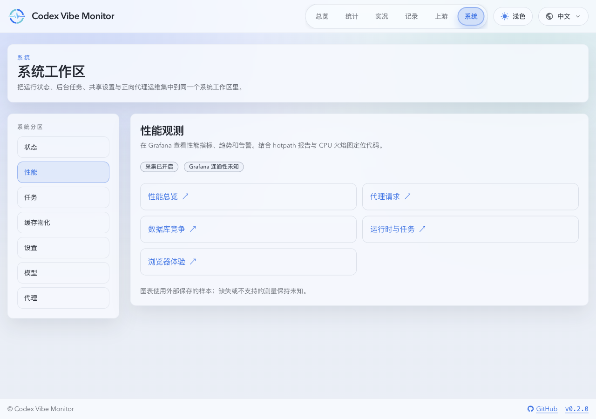
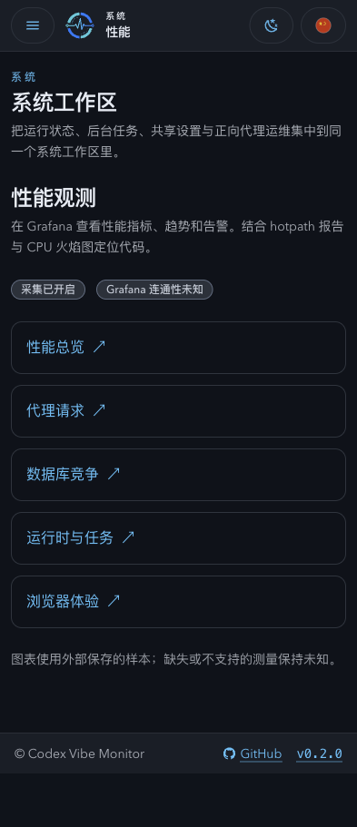
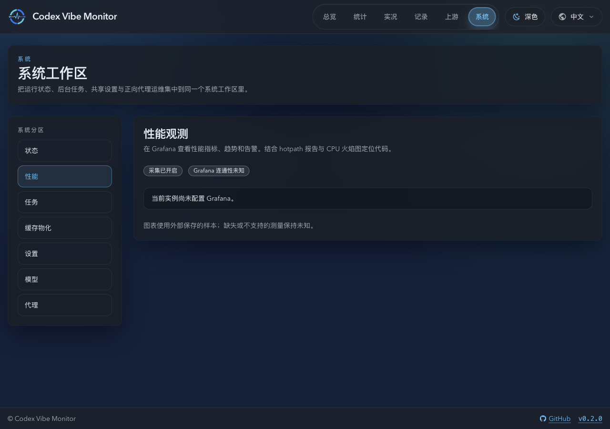
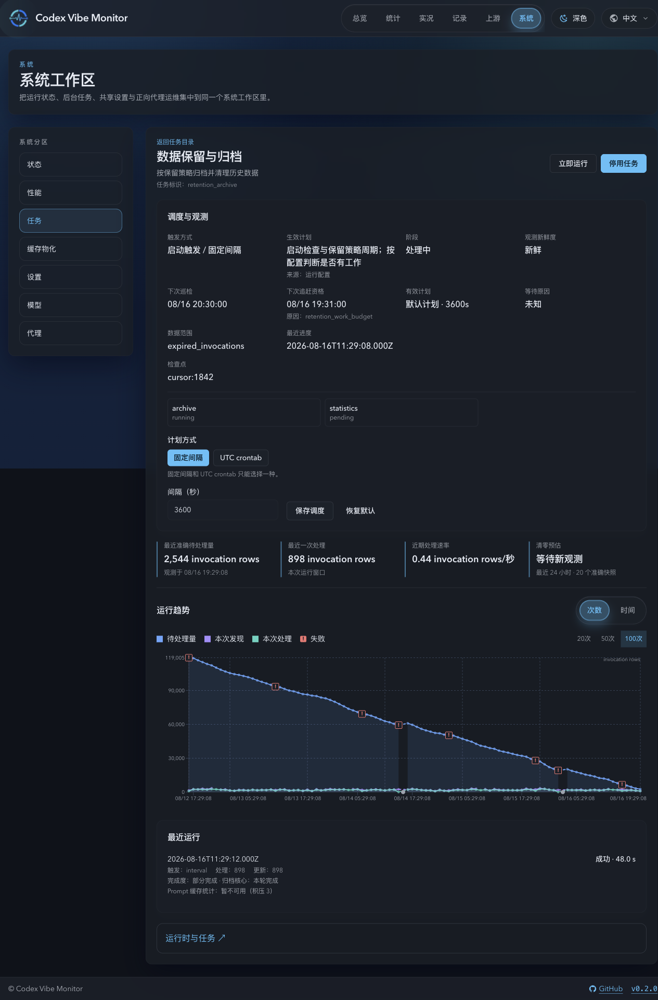

当前生命周期统计、分类案例和原生 Trace 瀑布图来自隔离 Grafana/Tempo synthetic preview；桌面视口为 1280×900，移动视口为 393×852，使用固定 UTC 时间窗和合成 fixture。六张截图均已向主人展示并确认准确；新路径相对于基线为 current-only，页面级 trim-only 预处理均无需裁剪。

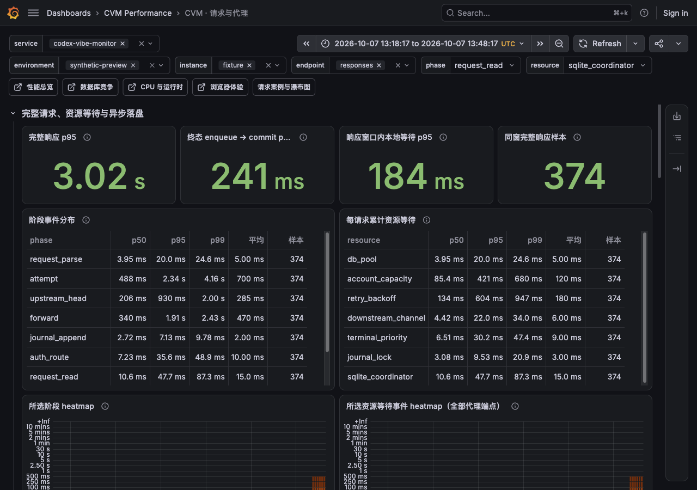
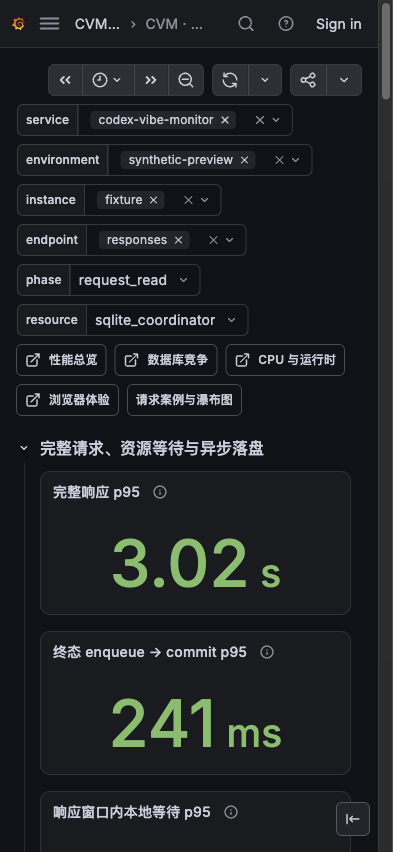
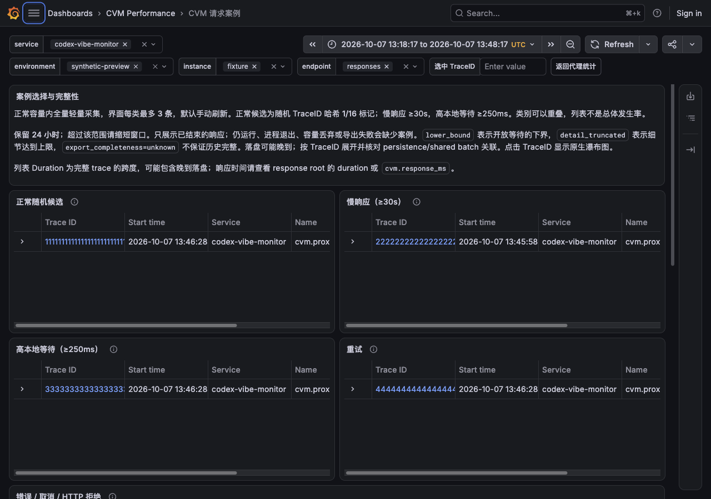
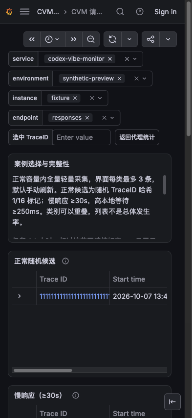
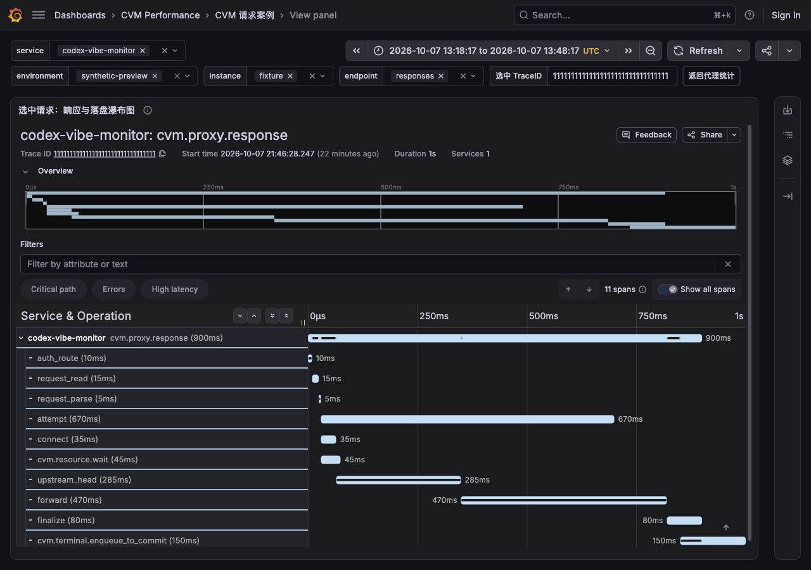
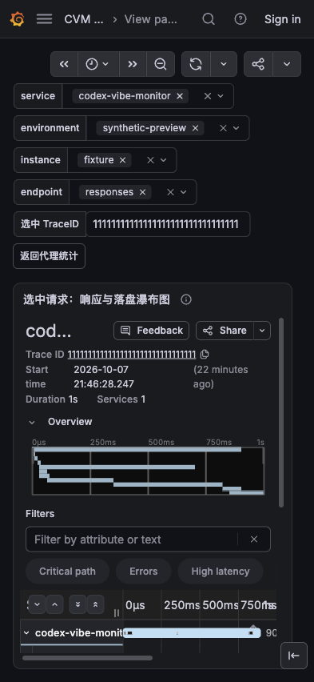

代理运行态健康证据来自当前仓库实际 provision 的隔离 Grafana/Prometheus synthetic preview。桌面视口为 1280×900，窄屏视口为 393×852；截图只包含数量/保护计数、年龄/物化延迟和内存/日志容量三个面板，保留 Grafana 原生滚动图例。两张新增图片没有同路径基线，已展示并获主人确认准确；页面级 trim-only 处理未裁剪。

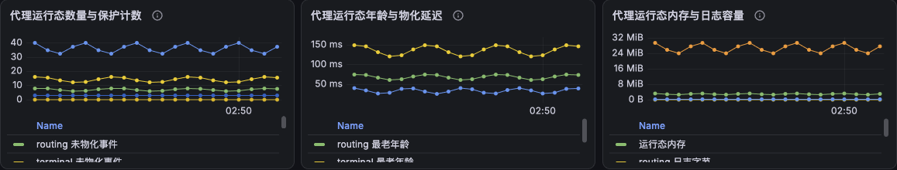
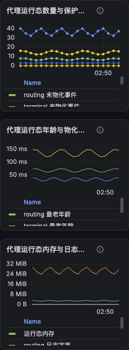

归档、补算、统计、比较和终态保护证据使用隔离 Agent VM 中实际 provision 的 Grafana/Prometheus 合成预览。桌面视口为 1440×1000，窄屏为 393×852，通过视口模拟和面板区域截取保留真实 Grafana 布局与原生滚动。正常、维护库锁冲突、低样本和缺测分别使用固定 fixture；缺测保留 Unknown，历史窗口没有样本时不伪造对照值。截图中的各自五分钟合成窗口用于验证展示，不表示生产优化幅度。十张 current-only 图片没有同路径基线；归档桌面与窄屏图展示独立 transaction、完整 write_hold 和同窗阶段样本。补算桌面图仅为有未确认义务且已排期的任务显示倒计时；窄屏图展示无未确认义务时的 Unknown。图片均已向主人展示并确认准确。页面区域裁剪不改变图表内容。

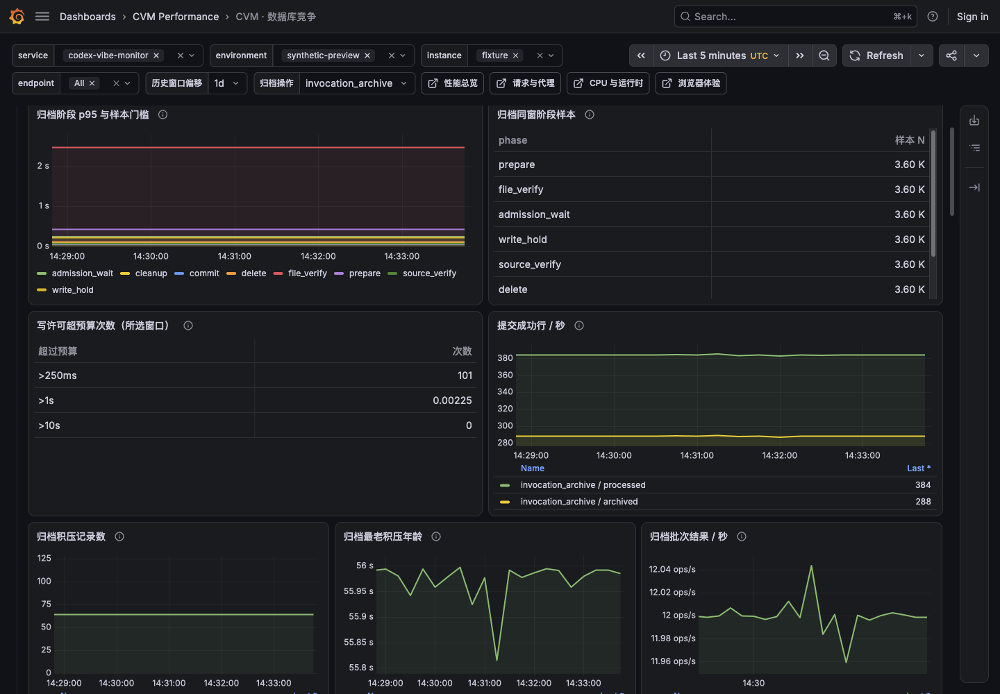
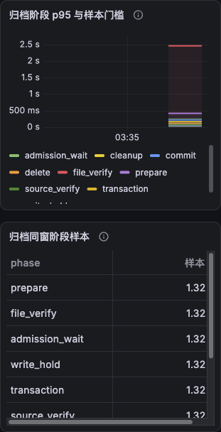
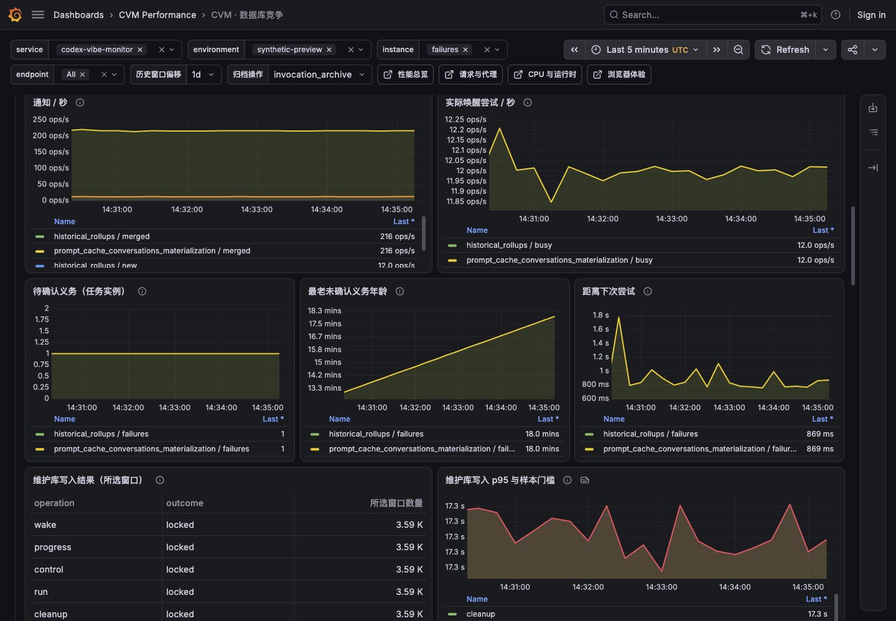
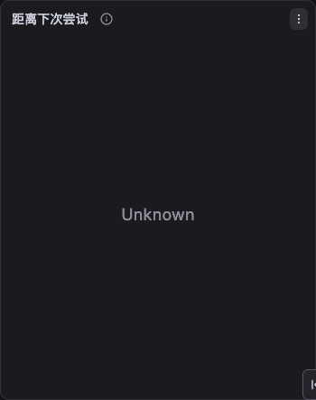
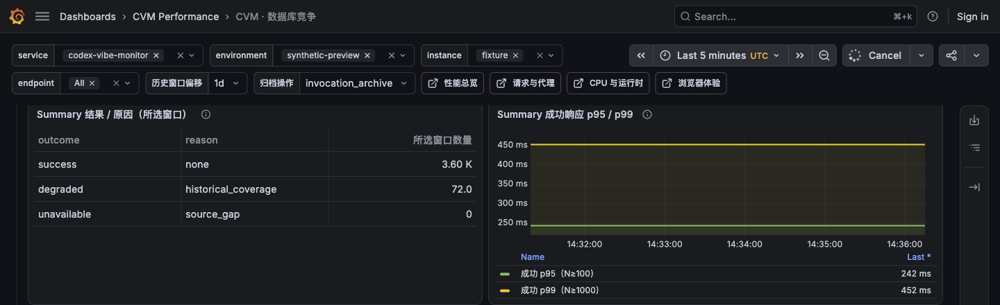
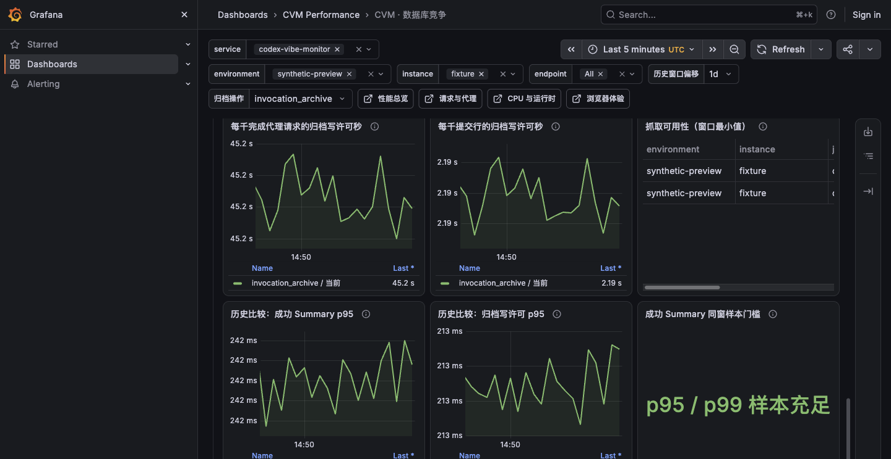
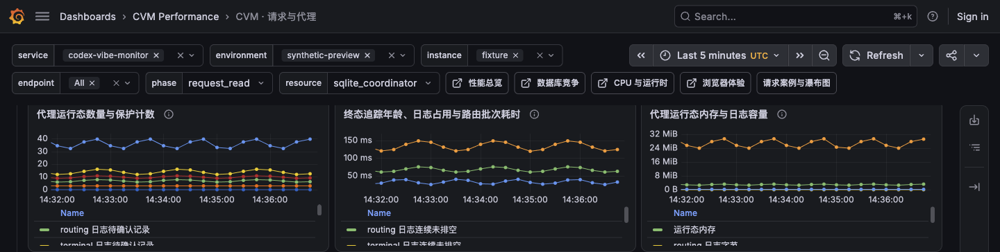
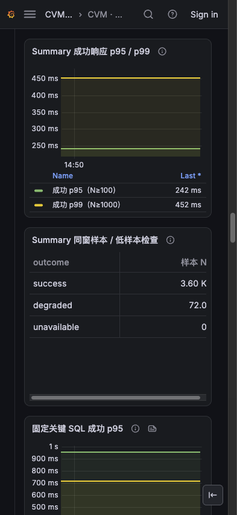
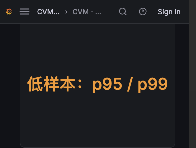
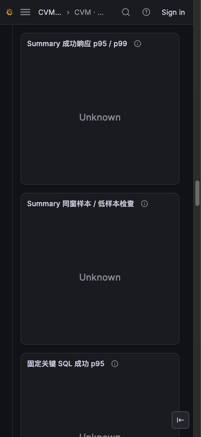
