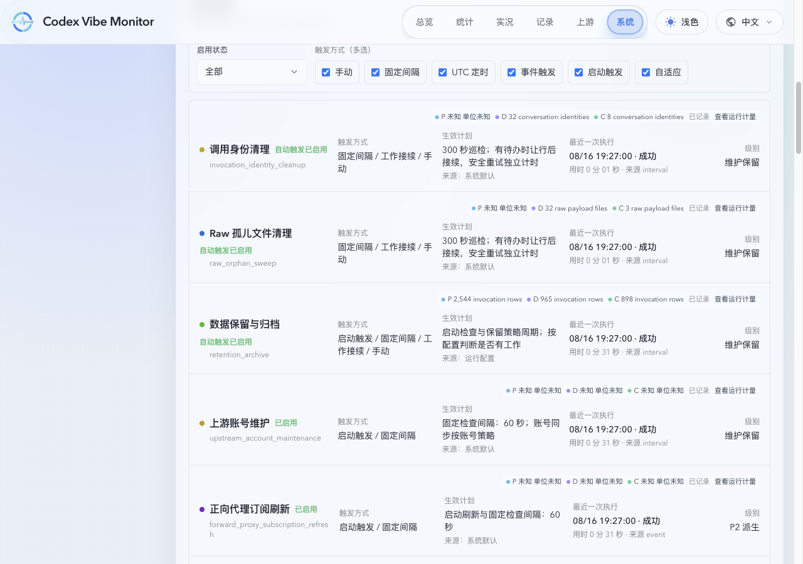
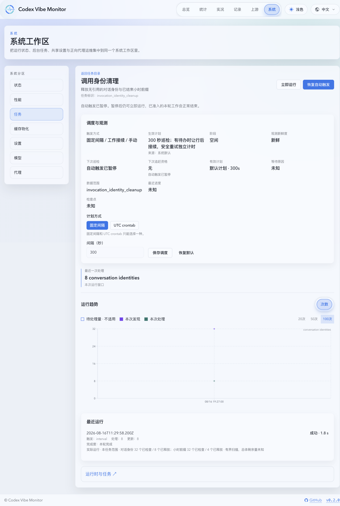
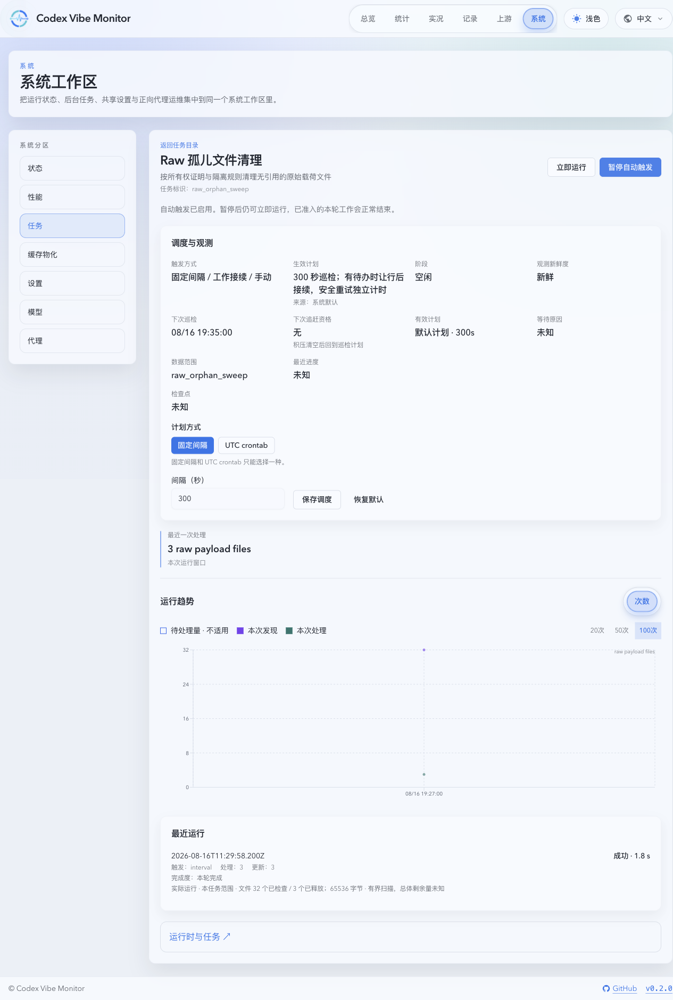
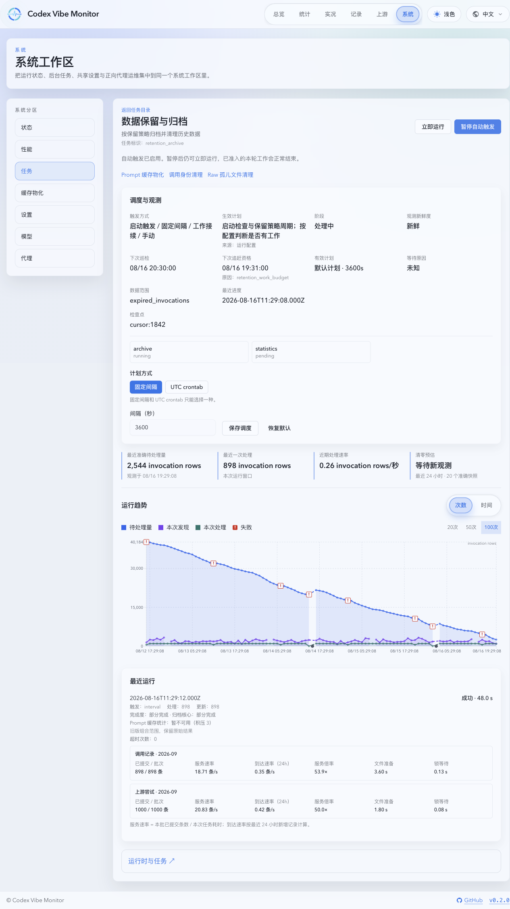
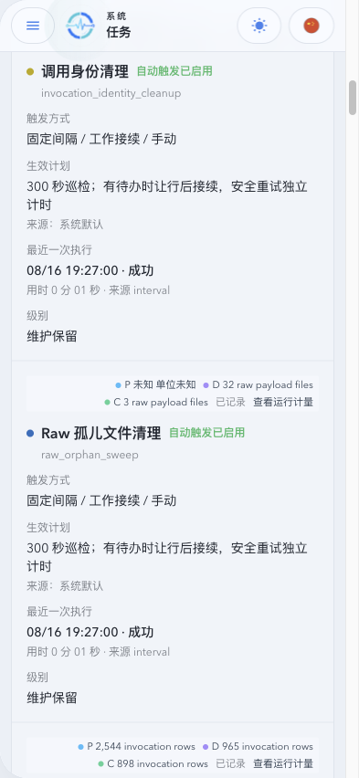

# 数据保留维护任务归属实现状态

## Current Status

- Implementation: 已实现；数据库替换竞态、编译合同、owner 失败重试与租约冲突事实已修复，详情裁剪覆盖门禁、取消事实、失败退避资格、shutdown observation 重放、归档 no-progress watchdog、raw 文件删除计量、dry-run 接续约束、预演文件计量、native worker 排空、task-run history 的 SQLite 压力延期事实和 Rust source-quality inventory 基线已补齐。历史批次曾记录 `a5cf8bd9` 等修复 head；当前候选、PR 头、远端 CI 与迁移回放状态以当前候选验证卡为准，生产二进制与十四来源升级和进程验证使用的历史二进制保持可追溯。

- Lifecycle: active。
- 需求与 ADR 已确认；当前工作分支按批准计划实现同一 PR，交付停在 merge-ready。

## Implementation Coverage

- `REQ-RMO-001`, `REQ-RMO-005`, `REQ-RMO-006`：归档移除身份清理和 raw 孤儿预演，两个清理使用共享请求／执行入口；raw 自主 worker 与旧归档 worker 已退出。身份每轮检查最多 32 个对话和 32 个小时前缀，共享独立 2 秒工作预算；raw 保留原候选上限、遍历和释放协议。巡检、工作接续与安全重试独立记录。
- `REQ-RMO-002`, `REQ-RMO-003`, `REQ-RMO-004`：移除两项环境输入；新增控制默认启用与 300 秒巡检，事务初始化使用 `retention_maintenance_ownership_v1`，保留已有控制与计划。七项开关只控制自动请求准入，已接受手动请求与已准入有界执行保留，恢复从当前时间排期。物化在轮次准入固定控制，保留源代际和提交围栏。
- `REQ-RMO-007`, `REQ-RMO-008`, `REQ-RMO-009`：沿用归档源转换／统计失效／刷新入队事务；身份使用实际运行管理器和资源准入，新增小时 scope 以删除与游标同事务提交。查询超时后 SQLite 连接关闭完成前保留身份围栏；raw 保留隔离、文件身份、库存与 release-pending 保护。
- `REQ-RMO-010`：CLI 在业务初始化和启动恢复前选择在线请求或离线独占路由。运行态锁同时绑定规范化数据库路径对、当前数据库 inode 对与两个数据库文件本身；在线请求保留服务就绪标记文件和数据库描述符证明，使用同一受保护 VFS 打开维护库，并在请求写入及轮询期间持续复核，路径替换或服务锁释放均在 SQLite 写入前拒绝。初始化、离线 CLI、混配数据库对、替换 inode 与 hard-link 别名均在打开 SQLite 前拒绝。离线多链接数据库返回不可用，避免不同日志路径写同一数据库。在线不初始化控制或回收活跃运行，离线只执行指定任务并在释放锁前关闭连接池。三个预演使用局部扫描状态，不改业务删除、正式游标或释放事实。
- SQLite 连接固定到持锁文件的规范化路径，在原生 Unix VFS 的路径解析和实际打开边界重查路径／描述符身份及单链接证明，并使用 `SQLITE_FCNTL_HAS_MOVED` 检查 SQLite 打开的真实文件。校验发生在 journal／schema 初始化前；连接池后续连接继承同一 VFS 入口。归档 ATTACH 沿用原生实现。VFS 注册对象随进程保留以满足 SQLite 指针寿命，正确性证明使用弱引用，不延长数据库锁寿命；连接池关闭后才能释放运行态锁，包括初始化失败路径。活动连接的数据库、journal／WAL 与共享内存回调持续检查证明和文件身份；mmap 禁用以保证访问经过校验，原生文件保持独立布局及方法表。新实例取得每个协议锁时立即清除旧就绪标记。
- `REQ-RMO-011`, `REQ-RMO-012`：新记录包含职责版本、scope 与 dry-run，计量分离调用行、对话、小时、文件及字节，缺测保持未知。新增目录和详情、自动触发文案、暂停时立即运行、归档关联入口及旧组合历史标识。资源等待与实际开始分开记录，保留旧历史口径。
- `REQ-RMO-013`：新增维护库重试状态表及业务小时清理 scope；既有迁移保持不变。直接升级来源逐一覆盖 v4.0.0 至 v4.0.6、v4.1.0 至 v4.1.3、v4.2.0 至 v4.2.2，不以版本等价假设共用来源。最终 Linux 二进制的十四来源升级和进程安全验证已通过，生产字节一致；`ba4a74a9` 是历史修复批次，当前候选与远端验证状态以当前候选验证卡为准。
- `REQ-RMO-005`, `REQ-RMO-011`, `REQ-RMO-014`：自动归档失败在维护库 finalizer 中保留不确定性并安排 300 秒 owner_failed catch-up，即使失败前的 backlog 快照为零；同一 owner 的执行租约冲突写入明确 `failed`、ownershipVersion=2、`task_execution_active` 和有界重试资格，避免缺少 completion/details 的不可解释失败。历史清理由 `task_run_history_cleanup` owner 分批执行，schema 初始化不再隐式删除工作量样本。新增 stateful SQLite 失败重试回归与 dispatcher 事实构造回归。
- `REQ-RMO-011`, `REQ-RMO-013`, `REQ-RMO-014`：模型路由 owner 以真实剩余量决定接续，历史清理在后续批次失败时保留已提交行数，重试计划写入失败时 finalizer 继续使用已持久化的业务事实并按 run generation 保护 catch-up；七个 v2 owner 的实际工作观测、压力退避、归档批次明细和旧版范围显示均与独立 task key 对齐。暂停回归覆盖全部 v2 owner，避免新增默认任务绕过暂停契约。

- REQ-RMO-005、REQ-RMO-011、REQ-RMO-013、REQ-RMO-014：第十六批让独立 invocation_detail_prune owner 复用 parallel-work minute coverage gate，在证明加载取消或预算停止时写入 deferred facts；失败 retry state 同时约束 catch-up 与正常周期触发，旧 finalizer 和 shutdown journal 均按 run generation 与完整 observation 保持重试意图。
- REQ-RMO-005、REQ-RMO-011、REQ-RMO-013、REQ-RMO-014：第十七批修复重试排期的 move 后借用编译错误；为同步归档 worker 增加外部 no-progress watchdog 并保留 lease drain；把 raw 文件删除计量写入批次 observation；保留 identity/raw 的安全退避；在租约冲突排期失败时持久化重试意图；并让 dry-run 不生成真实清理 catch-up。
- REQ-RMO-005、REQ-RMO-011、REQ-RMO-013、REQ-RMO-014：第十八批让 retry state 在释放 active-run 约束前持久化；让失败事实保留已知或未知的 hasMore；将预演 raw 文件计量拆为 `rawFilesPlanned` 与实际 `rawFilesRemoved`；历史解压刷新进度并在 watchdog 后等待 native worker 排空；归档哈希统一经过外部文件 watchdog；前端按预演或实际运行显示对应字段。

## Verification

- 历史验证快照曾绑定代码候选 `3d7ee15a3ca09c85f910e15cc5625222f3dd0029` 与主干 `ed00c68fed0975aaf0617981db8ad7fd75ce1a1f`；当前候选、主干基线、输入指纹和文档承载关系以当前候选验证卡为准。随后的证据提交只修改文档，实际二进制和程序输入保持对应关系。
- 后端共享 runner 三个资源组通过：本轮完整刷新 lightweight 1302/1302；stateful-sqlite 1457/1457 和 archive-file-io 337/337 保留第六批证据。当前 Git 差异仅涉及两个 lightweight 的 `cfg(test)` 函数，移除其函数体后的文件其余字节相同，共享初始化、测试入口及生产代码不变。九项运行态／活动 SQLite I/O 回归通过；Rust fmt、`cargo check --locked --all-targets --all-features`、`cargo clippy --locked --all-targets --all-features -- -D warnings`、源码质量与质量／后端测试脚本合同通过。
- 文档首页、部署与排查说明已对齐默认自动启用；会话 VM 的文档站构建及文档 lint 通过。Web 类型检查、lint 与构建通过；完整单测 179 文件／1838 通过／6 跳过，相关组件 Storybook 3 文件／14 状态通过，mock-only demo 的桌面／移动端与路由 Playwright 12/12 通过且未启用重试。lint 退出成功，保留 92 项 warning 事实，不宣称无诊断。
- 真实 Linux 程序使用 `cargo build --locked`、单编译进程和 `CARGO_PROFILE_DEV_DEBUG=0`，保留默认 hotpath features。二进制 SHA-256 为 `4f52d04dd685f4843344cd00ba14884e3b5fb6ca1220bf91e91685399c71ba51`，取回后再次核对一致。十四个独立发布来源全部完成升级、重复初始化、只读预演、暂停时真实手动入口、归档职责隔离、受保护身份及中断后的前向重入；[升级结果](../../adr/assets/retention-maintenance-task-ownership/released-state-upgrade-results.json) 的所有来源绑定该摘要。
- [实际进程验证](../../adr/assets/retention-maintenance-task-ownership/runtime-validation-results.json) 使用 v4.2.2 来源及同一二进制，八项声明全部通过：在线 CLI 不初始化不可用维护库、三种只读职责、归档独占范围、四项暂停后的手动运行、CLI／页面竞争、无启动恢复、无手动自动接续及优雅关闭后的锁释放。Linux 命名运行态锁与 raw 预演释放计量回归包含在通过的 archive/file-I/O 组中。
- Linux 三个共享资源组在第六批按顺序执行，本轮刷新轻量组。轻量组把共享 runner 及进程树固定到一个来宾 CPU；SQLite 与归档组维持原 profile 并行度，通过标准 Cargo target runner 为每个真实测试进程租用独立来宾 CPU，保留原二进制、argv 和退出状态。projection 与统计检查点夹具使用已有独占槽；测试计时前的 CPU 槽等待上限为 30 秒。权限夹具移除 root DAC override，生产阈值和断言未放宽。
- 主干的公平统计队列、分页、实时 overlay、单样本 workload marker 与整页 Storybook 清理均已保留。整页状态与交互由 mock-only demo 覆盖，吞吐、时间线及 workload marker 由组件 Storybook 覆盖。六张页面图片已获主人确认；主干同步后核对相关产品组件、路由、样式和 demo 输入，当前视觉比较一致；最终 head 的 dry-run 变体仍待主人确认。
- `VER-RMO-001` 至 `VER-RMO-008` 的证据映射、各输入指纹与日志摘要见 [当前候选验证卡](../../adr/assets/retention-maintenance-task-ownership/current-candidate-validation.json)。第六批修复覆盖初始化失败时关闭连接池、活动 SQLite／sidecar 替换及锁接管期间旧就绪标记撤销；九项命名回归、全部后端资源组、十四来源升级和八项实际进程声明通过。历史候选 `ba4a74a9` 额外覆盖 task-run history 在 SQLite 压力下保留 owner deferred/retry facts；当前交付证明只采用当前候选验证卡及最终 PR 头上的 CI 结果。

- 本轮 CI 修复的常规时点、上海 00:00／00:01／00:03／12:00／23:59:50 及从 23:59:58 跨午夜的进程偏移验证全部通过；CLOCK_MONOTONIC 与系统时钟未改变。修复前同一二进制在 00:01 稳定复现 `today` 1 对 2，00:03 通过。预期独立按记录日期计算，不复用实现中的窗口选择函数，不增加跳过、重试或放宽限制。机制及结果见 [时钟验证](../../adr/assets/retention-maintenance-task-ownership/summary-clock-validation.json)。
- 本轮默认 feature 的生产构建 SHA-256 与第六批逐字节一致，因此十四来源升级与八项进程结果按其原执行来源保留，结果卡明确记录当前候选与原执行候选。未把保留结果写成重新执行。额外完整工具夹具 wrapper 因快照资源未完成；必需的质量声明检查与后端 runner 合同通过，工具源码未改变，未宣称完整 wrapper 成功。
- 第十三批 CI 修复前的 PR head 在测试目标编译阶段暴露 `.shared()` 缺少 `FutureExt` 导入；新增显式测试导入后，失败归档重试与租约冲突事实回归均绑定到新的代码候选。随后 docs carrier `989b044e` 的 exact-head CI 暴露轻量迁移夹具仍期待 schema 隐式删除 5 条样本，以及 Clippy 的 `.bind(&finished_at)` 无必要借用；第十四批代码候选 `cb4c1bef` 已修复两项，本地允许的格式与差异检查通过，远端 CI、迁移回放和正式复审仍待验证。
- 第十三批 CI 修复前的 PR head 在测试目标编译阶段暴露 `.shared()` 缺少 `FutureExt` 导入；新增显式测试导入后，失败归档重试与租约冲突事实回归均绑定到新的代码候选。随后 docs carrier `989b044e` 的 exact-head CI 暴露轻量迁移夹具仍期待 schema 隐式删除 5 条样本，以及 Clippy 的 `.bind(&finished_at)` 无必要借用；第十四批代码候选 `cb4c1bef` 已修复两项。其后 c55 的 exact-head stateful CI 暴露暂停测试仍只停用旧四项任务，第十五批代码候选 `cfe996f5` 已扩展到七个 v2 owner；本地允许的格式与差异检查通过，远端 CI、迁移回放和正式复审仍待验证。

- 第十六批代码候选 95b95759 通过本地 cargo fmt --all -- --check 与 git diff --check，并由签名 Conventional Commit 交付。1371a7da 的三次匹配 CI PR 运行均失败，不能作为当前候选证据；新头的 exact-head CI、迁移回放、fresh formal review 与当前 head 证据刷新仍待验证。
- 第十七批代码候选 f28248f6 通过本地 cargo fmt --all -- --check 与 git diff --check，并由签名 Conventional Commit 交付；026e37d9 的两次匹配 CI PR 运行均因 `at` move 后借用编译错误失败，不能作为当前候选证据。其后第十八批代码候选 370be26c 通过本地 cargo fmt --all -- --check 与 git diff --check，并由签名 Conventional Commit 交付；主干切换为 serial observability bundle 后，`3508ab41` 的 formal review 发现 candidate-source drift 夹具漏复制 ADR 0047，第十九批修复提交 `27eb5b13` 已补齐清单；随后签名合并 `e2144679` 同步主干 `e956d1a8`，最终 head CI `39764651636` 及三个辅助 workflow 全部通过，五 lane formal review clear，迁移回放与 current-head UI evidence 仍待验证。

## Visual Evidence

来源：mock-only `ui_demo`；桌面 1280 CSS px，移动端由 demo iframe 固定为 393×852 CSS px。六张图片在锁定基线不存在同路径旧图，按 current-only 比较展示后已获主人明确确认；无需裁剪，不使用生产数据或真实程序截图。

## Rollout and Remaining Gaps

- 发布影响按 Minor 记录：主人明确临时环境开关不属于兼容承诺；旧部署文档将一次性 CLI 描述为归档入口，未承诺附带孤儿清理。保留归档命令、任务标识、URL 和旧历史，新增独立清理入口及自动触发控制。旧命令不再附带孤儿清理是明确披露的行为变化，不宣称执行范围完全相同；持久状态单独按可加性 Minor 验证。
- 直接来源逐一为 v4.0.0 至 v4.0.6、v4.1.0 至 v4.1.3、v4.2.0 至 v4.2.2；各来源由对应发布镜像独立生成，来源与镜像摘要保存在 [released-state-sources.json](../../adr/assets/retention-maintenance-task-ownership/released-state-sources.json)。更早 Major 必须先中间升级，不支持多版本同时写入。
- 实现从计划基线 `130c357c043a3449512a25cd82643fc5a8ca02df` 开始，按已授权同步合同保留备份并对齐主干；已发布后仅使用签名合并提交，当前基线为 `ed00c68fed0975aaf0617981db8ad7fd75ce1a1f`，保留主干统计公平队列及其回归，不重写已发布历史。
- 当前候选的本地工程检查、历史候选的十四来源升级回放与进程验证已完成；当前候选的十四来源迁移回放及远端 CI 仍 pending。发布来源夹具生成器现按 manifest digest 拉取并核对 `RepoDigests`，避免可变 tag 漂移；七个 owner-v2（含 `retention_archive`）的终结与 catch-up 更新在同一事务内提交，并有当前 run generation 回归；所有 owner-v2 终态与控制/调度更新都会刷新对应 progress projection 且不把旧 workload freshness 标为 fresh；deadline-expired dry-run candidate query 保留未知 workload facts；runtime failure detail 与 system-task journal/quarantine 现对包括 Basic、逗号分隔 Digest 参数和 `authorization=` 形式在内的完整 scheme/value 凭据统一脱敏；retention raw deletion plan 现于引用检查前取得独占 raw-directory fence，跨事务提交持有并在删除前重查文件 identity，writer 忙或 identity 被替换时保留文件并交给 inventory reconciliation；migration validation quality contract 已按变更范围门控其 producer、覆盖 Cargo 构建输入、`rust-toolchain.toml`、vendored hotpath sources、全部声明的 Cargo/Docker/validator 输入、full-history carrier checkout、可执行的双 validator 命令、身份断言、evidence upload 与 rerun-safe artifact overwrite；owner-specific fixture mutation、shared raw ownership、raw-file removal、replacement identity 与 archive-manifest content/identity assertions 现绑定当前代码候选 `dbb73f7be49f644a19ade4cd6e1ff84b6669d218`；本批同时修复 archive/file-io 测试在 `pool.close()` 前未释放连接的清理死锁，按 schema 默认 convention 修正 quota fixture 时间格式，并在迁移失败时保留 version、owner、脱敏 error chain、candidate.log 与 managed_task_runs.details，CI 失败路径通过 `always()` 上传受控诊断且成功路径仍对缺少证据 fail-closed；包含 `IMPLEMENTATION.md` 在内的四文件文档承载头、远端 CI、fresh Tier 4 只读审查和迁移回放均以当前候选验证卡及 PR #1162 的最终头为准，所有合并门禁通过后才可宣告 Step 5C Ready。

## References

- [Requirements](SPEC.md)
- [Background](HISTORY.md)
- [Ownership decision](../../adr/0034-retention-maintenance-task-ownership.md)
