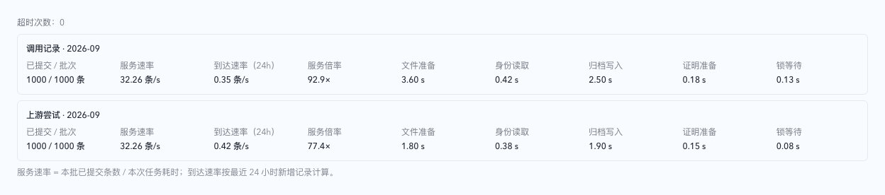
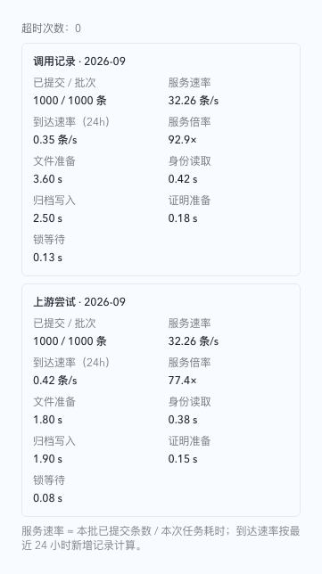
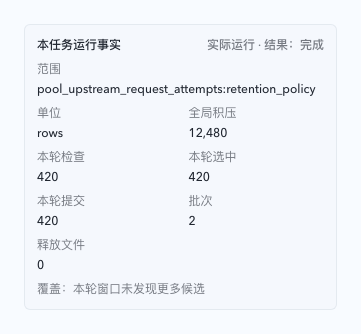
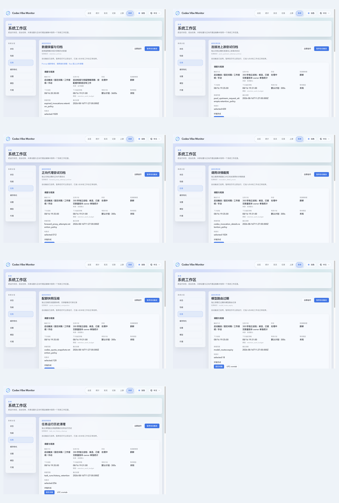
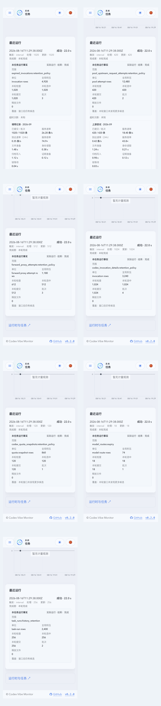
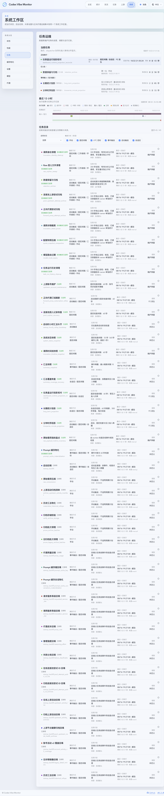

# 数据保留维护的独立任务归属与触发控制

## Context and Scope

本主题约束数据保留与归档、各项保留策略清理、Prompt 缓存物化、孤儿调用身份清理和 raw 孤儿文件清理的执行归属、自动触发控制、运行入口与观测。目标是让每项维护的完成度、故障、资源消耗和操作范围对应实际执行者。

范围包括 invocation 归档 owner 与六项独立保留策略 owner 的纳管、既有物化/身份/raw owner 的控制语义、移除环境启停开关、默认控制初始化、有限 dispatcher、任务级 CLI、页面与历史口径。现有归档格式、保留天数、统计精确性、身份分配和文件所有权协议继续适用；原始载荷指标盘点以及其他系统任务不并入这些 owner。

本主题定义七项 retention-policy owner 的归属和自动触发暂停语义。既有 retention 规范继续定义归档安全、统计和资源约束；其中把会话派生维护计入归档总体完成度、把任务停用视作正在运行任务的批次暂停等旧规则，在新 owner 上由本主题的独立归属与触发控制要求接管。

## Terms and Interfaces

- 归档核心、自动触发暂停、纳管任务与任务运行采用 [CONTEXT.md](../../../CONTEXT.md) 的定义；每个 owner 的 `discovered`、`selected`、`committed` 和 `result` 是本主题的运行事实。
- 下表定义七项 retention-policy owner 的任务标识和工作范围；`raw_compression`、`prune_archive_batches`、`prompt_cache_materialization`、`invocation_identity_cleanup` 与 `raw_orphan_sweep` 仍由各自既有 owner 负责，不被重新并入归档核心。

| 任务                | 标识                            | 工作范围                                                                        |
| ------------------- | ------------------------------- | ------------------------------------------------------------------------------- |
| invocation 归档     | `retention_archive`             | 固定 cutoff/source fence 下的 invocation 归档、证明、源转换与关联 raw 释放。    |
| 上游尝试归档        | `pool_upstream_attempt_archive` | 独立归档过期的连接池上游请求尝试。                                              |
| 正向代理尝试归档    | `forward_proxy_attempt_archive` | 独立归档过期的正向代理尝试。                                                    |
| invocation 明细裁剪 | `invocation_detail_prune`       | 独立裁剪保留窗口内已完成 invocation 的详情数据。                                |
| 配额快照压缩        | `quota_snapshot_compaction`     | 独立压缩历史配额快照并保留每日代表记录。                                        |
| 模型路由过期        | `model_route_expiry`            | 独立清理已过期模型路由记录。                                                    |
| 任务运行历史清理    | `task_run_history_cleanup`      | 独立清理主库 `system_task_runs` 审计历史和维护库 `managed_task_runs` 调度历史。 |

冷 raw 压缩与过期归档批次清理继续复用 `raw_compression` 与 `prune_archive_batches` owner；identity/raw orphan 与 Prompt-cache owner 继续使用既有执行者和安全边界。

- 管理接口沿用 `/api/system/managed-tasks` 及其按任务读取、控制和立即运行的既有入口。
- `--retention-run-once` 与其 dry-run 仅对应 invocation 归档职责；六项保留策略 owner、身份清理和 raw 清理各自具有独立的一次性运行和 dry-run 入口。
- `RETENTION_ENABLED` 和 `XY_RETENTION_ENABLED` 退出支持的运行配置，不作为任何初始化或运行输入。其他保留策略、归档位置和预算配置仍按对应职责的既有合同生效。

## Requirements

### REQ-RMO-001 — 七项执行归属

系统 MUST 为七项 retention-policy owner 提供独立任务身份、实际执行观测、运行历史、计量、完成度、等待原因与重试状态。物化 MUST 复用既有执行者；raw 清理 MUST 纳管既有 worker，不能新增第二个执行者。身份清理 MUST 从归档执行链迁出，包含对话身份和小时调用前缀；归档原子转换中的关联 raw 文件释放仍属于 invocation 归档 owner。

### REQ-RMO-002 — 自动触发控制与默认值

任务页持久控制 MUST 独立决定各任务是否允许自动触发。停用一个任务 MUST NOT 修改其他任务的控制。新安装的七项 retention-policy owner 及首次引入的既有清理 owner MUST 默认允许自动触发；已有控制和管理员计划覆盖 MUST 保留，重复启动或升级不得恢复默认而覆盖操作员选择。

### REQ-RMO-003 — 移除环境启停输入

系统 MUST 完全不读取、解析、校验、拒绝或导入 `RETENTION_ENABLED` 与 `XY_RETENTION_ENABLED`。两者遗留为 true、false 或非法文本时 MUST 不影响启动、控制初始化和运行；文档、部署示例和生效策略说明 MUST 删除它们的控制作用。不迁移旧环境值造成的自动停用结果；已有任务控制允许自动触发时，旧环境值不能阻止其运行。

### REQ-RMO-004 — 停用只暂停自动触发

自动触发暂停 MUST 阻止新的启动、事件、周期、cron、追赶和恢复重试运行，不禁止页面立即运行、CLI 显式运行或 dry-run。已经开始的有界运行 MUST 保留正常范围、预算、压力准入和关闭规则，不因暂停自动触发而取消或提前截断。已接受的手动请求 MUST 不因之后暂停自动触发而被拒绝。手动运行 MUST 不改变暂停状态，剩余工作不得自动接续；恢复自动触发不得补跑错过的计划 occurrence。

### REQ-RMO-005 — 独立且有界的清理调度

两个清理任务 MUST 在尚有候选需要检查或已提交恢复工作需要收尾时有界接续，批次间让行；耗尽本轮扫描后 MUST 回到五分钟空闲巡检。受保护候选不能形成忙循环。压力、资源准入拒绝和实际错误 MUST 使用原因明确的退避；检查时间、接续或重试资格与实际开始时间 MUST 分开呈现。实际 owner 失败和同一任务执行租约冲突 MUST 保留明确的失败事实并安排有界下一次资格；缺少完成观测不得清空 catch-up。身份清理 MUST 使用自身运行预算和有界查询，不消耗归档轮次的剩余预算；raw 清理 MUST 保留现有有界扫描、共享工作预算与可恢复退避语义，不将排队或收尾时间冒充工作预算。

### REQ-RMO-006 — 单实例与真实执行边界

同一任务的自动调度、接续、页面请求和 CLI 请求 MUST 共用单实例与安全执行规则。并发入口不能产生重复执行者；显式运行仍 MUST 遵守资源准入、前台写优先级和删除保护。请求入队时间 MUST 与实际开始时间区分；纯等待、心跳或观测写入不能计为业务进展。独立任务不代表绕过它们共享的数据库和文件资源约束。

### REQ-RMO-007 — 归档与派生统计的事务关系

归档发布、摘要与源身份证明、源记录转换及关联 raw 所有权变化 MUST 保持既有原子合同。源调用变更、相关统计失效和刷新入队 MUST 在同一业务事务提交；归档事务不得同步聚合历史会话统计。物化 MUST 独立消费已提交需求并保持精确读合同；物化待办、暂停或失败不得把已完成的归档运行改为部分完成或失败。

### REQ-RMO-008 — 调用身份释放安全

身份清理 MUST 同时保护 Prompt Cache Key 引用、Conversation ID 引用、活跃占用、待分配身份与号段操作，以及既有保留宽限。候选读取与删除之间新增引用或占用时 MUST 保留身份；释放与正确性游标提交必须遵循既有原子与围栏合同。小时调用前缀 MUST 满足已结束、无引用及无占用条件，并按独立单位计量，不能在拆分时遗漏其清理。

### REQ-RMO-009 — raw 文件释放安全

raw 清理 MUST 保持既有文件身份与引用重查、文件锁、隔离宽限、release-pending 恢复和物理库存合同。存在有效所有者、身份变化或证明不完整时 MUST 保留文件。任务纳管、暂停、重启或升级 MUST 不清空既有隔离、待释放、失败退避或恢复事实，也不能将归档关联文件释放改为稍后无证明的孤儿删除。

### REQ-RMO-010 — 一次性入口与预演范围

`--retention-run-once` MUST 仅执行 invocation 归档 owner，不调用其他 retention-policy owner、身份清理或 raw 孤儿扫描。每个独立 owner MUST 提供有界的一次性入口和同范围 dry-run；入口不得运行其他任务或恢复自动触发。暂停自动触发时真实手动运行仍允许。dry-run MUST 不删除业务记录、释放身份、删除文件、推进正式正确性游标或改变隔离／释放事实；允许的运维观测或结构初始化必须与真实清理区分。预演 MUST 明示检查范围与覆盖，不能把一页候选结果称为全库总量。

### REQ-RMO-011 — 完成度与计量独立

每项任务的完成度 MUST 只依据自身本轮捕获范围和已提交成果。其他任务的后续推进 MUST 不改写已结束运行结果；没有进展、部分完成、延期与失败必须按对应原因呈现。调用行、上游尝试行、对话身份、小时前缀、文件与字节 MUST 分别计量；缺测或未知总体 MUST 保持未知，不能补零或生成混合单位完成率。

新 owner 运行 MUST 使用 `no-work`、`complete`、`partial`、`deferred`、`failed` 五种结果值。`discovered`、`selected`、`committed`、`globalBacklogTotal` 与 `selectedScope` MUST 分开持久化；`processedCount` 只能复述本 owner 的已提交事实，不能再把多个职责相加。旧 `retention_archive` 组合记录可继续使用 `completed` 等旧值，页面和接口必须按 ownership version 区分两种历史口径。

### REQ-RMO-012 — 页面与历史口径

目录、当前执行区和详情 MUST 分别展示七项 retention-policy owner 的真实状态、自动触发状态、计划来源、运行与等待原因。界面 MUST 明确停用表示暂停自动触发，停用时立即运行仍可使用；任务运行中仍须遵守单实例限制。归档页 MUST 通过关联入口连接物化、raw 与 identity 详情，新归档记录不得将它们或其他 retention-policy owner 作为自身执行阶段。raw 新执行与压力事件 MUST 归属于既有 raw owner。

旧 `retention_archive` URL 与历史 MUST 保持可读。旧记录的组合完成度、核心完成度及明细不得重算；新记录 MUST 明确自己的职责范围，缺少范围证据的旧记录按旧口径或未知展示，不伪造独立清理运行、历史零指标或新的完成结果。

### REQ-RMO-013 — 持久初始化、恢复与兼容证据

新控制和调度初始化 MUST 有序、幂等、可观测，并在任务自动准入前完成。业务正确性游标与所有权事实 MUST 留在既有业务存储，运维观测 MUST 继续使用维护库，维护库不可用不得增加同步主库观测写入。升级 MUST 保留已有控制、计划、正确性检查点和审计事实；中断初始化须能前向恢复，程序回滚不得隐式逆向迁移。

公开配置移除与持久状态兼容 MUST 分开评估。交付前 MUST 声明并验证受支持的已发布来源状态和中断恢复路径，不以源码阅读或文档检查代替兼容验证，也不改写已经部署的迁移。

### REQ-RMO-014 — Owner dispatcher 与固定事实

七项 retention-policy owner MUST 通过有界 dispatcher 执行，每个任务同时最多一个运行实例；dispatcher 不得 inline-await 完整任务、不得无限启动 worker，并 MUST 使用有限 worker/finalizer、显式队列、结果写入失败的重试与下一次资格。等待重资源时必须释放数据库连接、写许可和文件 fence，准入后重新校验 owner identity 与 source fence；租约冲突不得以缺少 completion/details 的失败结束 owner 运行，必须写入 `failed` 与 `task_execution_active` 事实并安排有界重试；shutdown/cancel 只能在 native worker 已退出后释放执行 lease。

## Verification

### VER-RMO-001 — 执行归属与事务

- Method: 任务目录、执行入口和成功／延期／失败场景的受控夹具，配合归档发布与刷新队列事务回归。
- covers: `REQ-RMO-001`, `REQ-RMO-006`, `REQ-RMO-007`, `REQ-RMO-011`
- Pass condition: 七项 retention-policy owner 各只有一个执行者；并发请求不重复运行；归档提交与刷新入队原子，派生任务故障不改变归档成果；进度单位和真实执行计时准确。

### VER-RMO-002 — 控制与默认值

- Method: 新维护库、已有关闭控制、管理员计划覆盖、重复启动及初始化中断夹具。
- covers: `REQ-RMO-002`, `REQ-RMO-003`, `REQ-RMO-013`
- Pass condition: 新任务默认自动触发，既有控制和计划不被重置；旧环境变量所有取值都无效且不导致配置报错；初始化可重复恢复，观测故障不回写主库。

### VER-RMO-003 — 暂停自动触发

- Method: 分别覆盖暂停前后到达的自动事件、已接受的手动请求、活跃运行、手动运行完成后的剩余待办与恢复自动触发。
- covers: `REQ-RMO-004`, `REQ-RMO-006`, `REQ-RMO-010`
- Pass condition: 暂停后不产生新自动运行；活跃有界轮次正常结束；手动请求仍可执行且不修改控制、不自动续跑；恢复时无错过 occurrence 的补跑风暴。

### VER-RMO-004 — 清理接续与预算

- Method: 使用可控时钟和候选／保护／空扫描／资源拒绝／实际失败夹具验证调度与独立预算。
- covers: `REQ-RMO-005`, `REQ-RMO-011`
- Pass condition: 有待办时分批接续并让行，空闲五分钟再巡检；保护候选不忙循环；退避原因、检查与重试资格准确；清理不消耗归档预算，扫描数不冒充总待处理量。

### VER-RMO-005 — 身份与文件删除安全

- Method: 在候选检查和提交间增加引用、活跃占用或文件身份变化，并覆盖隔离、release-pending、提交中断与重启。
- covers: `REQ-RMO-007`, `REQ-RMO-008`, `REQ-RMO-009`, `REQ-RMO-013`
- Pass condition: 所有受保护身份和文件仍保留；已结束无引用小时前缀可以按现有规则释放；游标与所有权事实正确恢复，归档证明和库存不被破坏。

### VER-RMO-006 — 一次性运行与 dry-run

- Method: 各独立入口覆盖允许／暂停自动触发、部分候选、错误和预演场景，并对比运行前后业务、文件及正确性检查点。
- covers: `REQ-RMO-004`, `REQ-RMO-010`, `REQ-RMO-011`
- Pass condition: 每个入口只处理指定职责；归档入口不执行孤儿清理；暂停时真实手动运行仍可执行；dry-run 无业务删除和正式游标推进，输出明示检查范围及未知覆盖。

### VER-RMO-007 — 页面和审计兼容

- Method: 新旧记录混合、缺少范围或指标字段、归档完成而相关任务待办、自动触发暂停和手动运行场景的界面与接口夹具。
- covers: `REQ-RMO-001`, `REQ-RMO-004`, `REQ-RMO-011`, `REQ-RMO-012`
- Pass condition: 七项 owner 详情和关联入口可用；暂停含义与手动按钮一致；旧 URL 与历史可读、旧结果不重算；新记录范围和事件归属准确，owner v2 的全局积压、本轮检查／选中／提交、单位与窗口覆盖可见，缺测不补零、不生成混合进度。

### VER-RMO-008 — 发布状态兼容

- Method: 对声明的已发布来源版本及中断发布状态执行升级、重复初始化和前向修复验证，分别记录公开接口与持久状态影响。
- covers: `REQ-RMO-002`, `REQ-RMO-003`, `REQ-RMO-009`, `REQ-RMO-012`, `REQ-RMO-013`
- Pass condition: 所有声明的来源夹具可恢复，操作员控制、恢复事实和历史保留；未验证来源不得宣称支持；无隐式逆向迁移或已部署迁移重写。

## Visual Evidence

- source_type: storybook_canvas
  target_program: mock-only
  capture_scope: element
  requested_viewport: desktop1280
  viewport_strategy: storybook-viewport
  margin_policy: require_margin
  evidence_surface: component
  surface_selector: `[data-visual-evidence-surface]`
  target_selector: `[data-visual-evidence-target]`
  story_id_or_title: `System/RetentionRunThroughput/Committed`
  state: committed throughput
  evidence_note: Desktop component surface shows retained throughput metrics; invocation archives expose all three phase durations while timestamped upstream archives expose source identity and archive writer durations and correctly show summary proof as unknown.
  image: 

- source_type: storybook_canvas
  target_program: mock-only
  capture_scope: element
  requested_viewport: 393x852
  viewport_strategy: storybook-viewport
  margin_policy: require_margin
  evidence_surface: component
  surface_selector: `[data-visual-evidence-surface]`
  target_selector: `[data-visual-evidence-target]`
  story_id_or_title: `System/RetentionRunThroughput/Mobile`
  state: committed throughput on mobile
  evidence_note: Mobile component surface keeps the phase timing fields readable without horizontal overflow at the 393x852 CSS viewport, including the explicit unknown summary-proof value for timestamped upstream archives.
  image: 

- source_type: storybook_canvas
  target_program: mock-only
  capture_scope: element
  requested_viewport: 393x852
  viewport_strategy: storybook-viewport
  margin_policy: require_margin
  evidence_surface: component
  surface_selector: `[data-visual-evidence-surface]`
  target_selector: `[data-visual-evidence-target]`
  story_id_or_title: `System/RetentionOwnerRunFacts/Mobile`
  state: owner v2 committed run facts on mobile
  evidence_note: Mobile owner-facts surface shows the independent scope, unit, global backlog, discovered, selected, committed, batch, raw-file and has-more facts without overlap or horizontal overflow.
  image: 

- source_type: ui_demo
  target_program: mock-only
  capture_scope: browser-viewport
  requested_viewport: 1280x852
  viewport_strategy: devtools-emulate
  margin_policy: trim_only
  evidence_surface: page
  state: seven retention owner detail pages with independent scheduling and scope facts
  demo_route: `/#/system/tasks/<owner-key>?demoTheme=light`; `retention_archive` uses `&demoRetentionOwners=v2` for the new owner record fixture
  sensitive_exclusion: N/A
  submission_gate: owner-approved
  evidence_note: Desktop gallery covers all seven retention-policy owner detail pages and shows each page title, task key, schedule context, independent data range and owner-specific progress facts.
  image: 

- source_type: ui_demo
  target_program: mock-only
  capture_scope: browser-viewport
  requested_viewport: 393x852
  viewport_strategy: devtools-emulate
  margin_policy: trim_only
  evidence_surface: page
  state: seven retention owner detail pages with mobile owner facts
  demo_route: `/#/system/tasks/<owner-key>?demoTheme=light`; `retention_archive` uses `&demoRetentionOwners=v2` for the new owner record fixture
  sensitive_exclusion: N/A
  submission_gate: owner-approved
  evidence_note: Mobile gallery covers the same seven pages at 393x852 CSS px, showing independent scope, unit, backlog, discovered, selected, committed, batch and window-coverage facts without horizontal overflow.
  image: 

- source_type: ui_demo
  target_program: mock-only
  capture_scope: browser-viewport
  requested_viewport: 1280x852
  viewport_strategy: devtools-emulate
  margin_policy: trim_only
  evidence_surface: page
  state: retention owner task catalog with seven owner entries
  demo_route: `/#/system/tasks?demoTheme=light`
  sensitive_exclusion: N/A
  submission_gate: owner-approved
  evidence_note: Full task catalog shows the seven retention-policy owner entries together, including their independent task keys and status rows, so page-level evidence is tied back to the split task directory.
  image: 

## Related ADRs

- [Runtime SQLite write admission](../../adr/0015-coordinated-runtime-sqlite-write-admission.md)
- [Task operations outside the main database](../../adr/0023-task-operations-state-outside-main-database.md)
- [Task runtime observation and effective schedules](../../adr/0024-task-runtime-observation-and-effective-schedules.md)
- [Retention core and conversation-derived maintenance](../../adr/0025-retention-core-and-conversation-derived-maintenance.md)
- [Task timeline HTTP pagination and SSE revision](../../adr/0029-managed-task-timeline-http-pagination-and-sse-revision.md)
- [Versioned task timeline SSE compatibility](../../adr/0030-versioned-managed-task-timeline-sse-compatibility.md)
- [Retention task-local batches and monthly targets](../../adr/0032-retention-task-local-batches-and-monthly-archive-targets.md)
- [Independent maintenance task ownership](../../adr/0034-retention-maintenance-task-ownership.md)

## References

- [Implementation coverage](IMPLEMENTATION.md)
- [Topic background](HISTORY.md)
- [Bounded retention contract](../bounded-retention-runs/SPEC.md)
- [Invocation identity contract](../proxy-invocation-identity/SPEC.md)
- [Raw retention recovery contract](../autonomous-retention-recovery/SPEC.md)
- [Planned compatibility impact](../../adr/assets/retention-maintenance-task-ownership/version-impact-record.json)
- [Planned durable initialization](../../adr/assets/retention-maintenance-task-ownership/persistent-state-migration-record.json)
